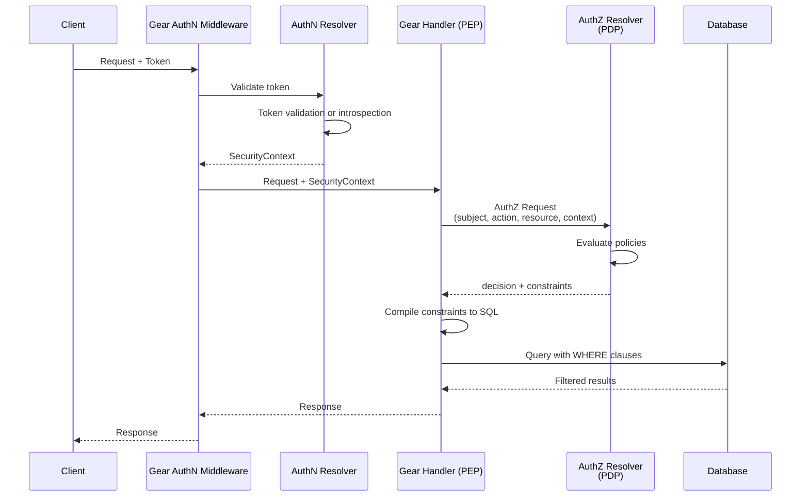
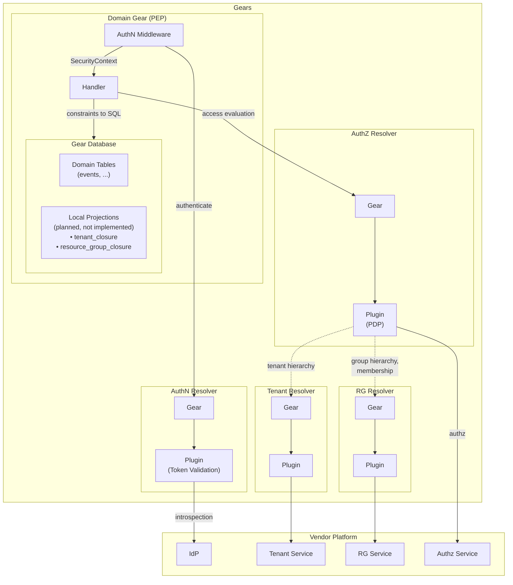
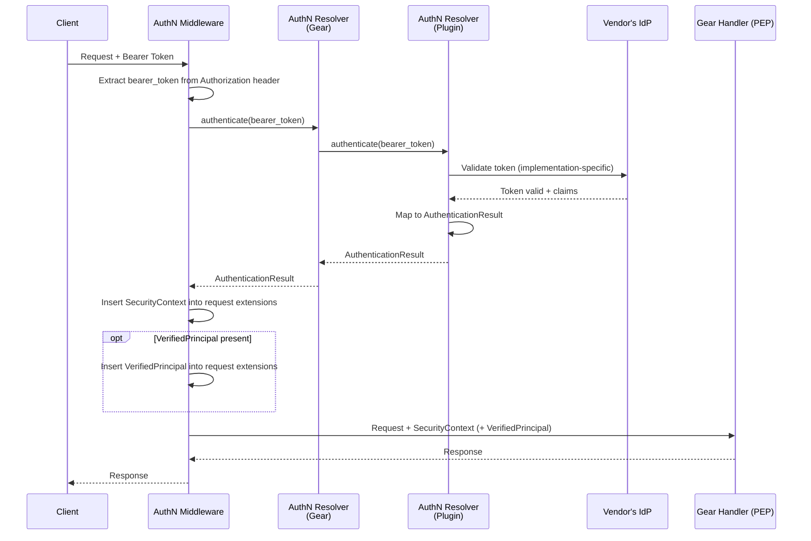
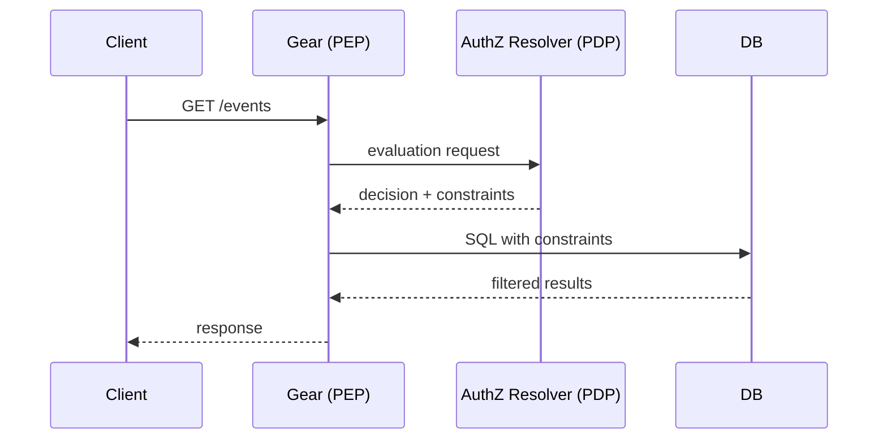
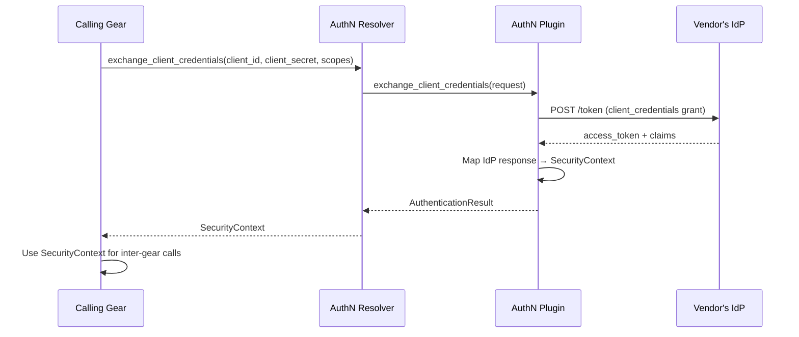

<!-- Updated: 2026-04-07 by Constructor Tech -->

# Authentication & Authorization Design

## Table of Contents

- [Overview](#overview)
- [Token Scopes](#token-scopes)
- [Authentication](#authentication)
- [Authorization](#authorization)
  - [Why AuthZEN (and Why It's Not Enough)](#why-authzen-and-why-its-not-enough)
  - [PEP Enforcement](#pep-enforcement)
  - [Authorization Decision Caching](#authorization-decision-caching)
  - [API Specifications](#api-specifications)
  - [Batch Evaluation (Access Evaluations API)](#batch-evaluation-access-evaluations-api)
  - [Predicate Types Reference](#predicate-types-reference)
  - [PEP Property Mapping](#pep-property-mapping)
  - [Capabilities -> Predicate Matrix](#capabilities---predicate-matrix)
  - [Table Schemas (Local Projections)](#table-schemas-local-projections)
  - [Usage Scenarios](#usage-scenarios)
- [S2S Authentication (Service-to-Service)](#s2s-authentication-service-to-service)
- [Open Questions](#open-questions)
- [References](#references)

---

## Overview

This document describes Gears' approach to authentication (AuthN) and authorization (AuthZ).

**Authentication** verifies the identity of the subject making a request. Gears use the **AuthN Resolver** gear to integrate with vendor's Identity Provider (IdP), validate access tokens, and extract subject identity into a `SecurityContext`.

**Authorization** determines what the authenticated subject can do. Gears use the **AuthZ Resolver** gear (acting as PDP) to obtain access decisions and query-level constraints. The core challenge: Gears need to enforce authorization at the **query level** (SQL WHERE clauses), not just perform point-in-time access checks.

See [ADR 0001](./ADR/0001-pdp-pep-authorization-model.md) for the authorization model and [ADR 0002](./ADR/0002-split-authn-authz-resolvers.md) for the rationale behind separating AuthN and AuthZ.

### PDP/PEP Model

This document uses the PDP/PEP authorization model (per NIST SP 800-162):

- **PDP (Policy Decision Point)** — evaluates policies and returns access decisions with constraints
- **PEP (Policy Enforcement Point)** — enforces PDP decisions at resource access points

In Gears' architecture:
- **AuthN Resolver** validates tokens and produces SecurityContext (separate concern from PDP)
- **AuthZ Resolver** (via vendor-specific plugin) serves as the **PDP**
- **Domain gears** act as **PEPs**, applying constraints to database queries

### Core Terms

- **Access Token** - Credential presented by the client to authenticate requests. Format is not restricted — can be opaque token (validated via introspection) or self-contained JWT. The key requirement: it must enable authentication and subject identification.
- **Subject** - Authenticated caller identity (user or API client) initiating the request, identified via access token (`sub` claim in OIDC/JWT terminology). *Note:* Some systems (e.g., AWS IAM) use the term **principal** for the same concept.
- **Tenant** - Domain of ownership/responsibility and policy (billing, security, data isolation). See [TENANT_MODEL.md](./TENANT_MODEL.md).
- **Subject Tenant** - Tenant the subject belongs to (home tenant).
- **Context Tenant** - Tenant scope root for the operation (may differ from subject tenant in cross-tenant scenarios)
- **Resource Tenant** - Tenant that owns the resource (data partition / isolation boundary).
- **Resource Owner Subject** - Optional subject bound to a resource instance for per-subject scoping (e.g., "my tasks"). Relationship semantics are domain-specific (creator, assignee, etc.) and do not imply administrative control.
- **Resource** - Object being accessed. Every resource belongs to a tenant and may optionally have a subject owner. Identified by type (GTS ID) and instance ID.
- **Resource Group** - Optional container for resources, used for access control. See [RESOURCE_GROUP_MODEL.md](./RESOURCE_GROUP_MODEL.md).
- **Permission** - `{ resource_type, action }` - allowed operation identifier. Canonical base GTS type: `gts.cf.toolkit.authz.permission.v1~`. See [PERMISSION_GTS_TYPE.md](./PERMISSION_GTS_TYPE.md) for the full schema, instance naming convention, and scenario examples.
- **Access Constraints** - Structured predicates returned by the PDP for query-time enforcement. NOT policies (stored vendor-side) or "grants" (OAuth flows, Zanzibar tuples), but compiled, time-bound enforcement artifacts computed at evaluation time.
- **Security Context** - Result of successful authentication containing subject identity, tenant information, and optionally the original bearer token. Flows from authentication to authorization. Required fields: `subject_id`, `subject_tenant_id`, `token_scopes`. Optional fields: `subject_type`, `bearer_token`.
- **Token Scopes** - Capability restrictions extracted from the access token. Act as a "ceiling" on what an application can do, regardless of user's actual permissions. See [Token Scopes](#token-scopes).

#### Ownership Model

In a multi-tenant system, resource access is defined along **two orthogonal dimensions**:

**Tenancy (mandatory, isolation boundary)**
Every resource belongs to exactly one tenant (`owner_tenant_id`). This is the primary data boundary.
PEP MUST always enforce a tenant predicate in queries to prevent cross-tenant data leakage, regardless of policy decisions.

**Subject scoping (optional, per-subject filtering)**
A resource may optionally be associated with a specific subject within the tenant via `owner_id`.
This enables "my resources" views (e.g., "show only my tasks"). Tenant-level shared objects may have empty `owner_id`. It aligns with AuthZEN's `resource.properties.ownerID` resource property convention (see [AuthZEN interop spec](https://authzen-interop.net/docs/scenarios/todo-1.1/)).

**Important semantics**
- `owner_tenant_id` is the isolation / partition key; `owner_id` is a nullable scoping attribute.
- `owner_id` MUST refer to a subject that belongs to the same tenant as `owner_tenant_id`.
- "Owner" here does **not** imply administrative control; it is used for scoping in policies/constraints.

**Policy usage**
PDP policies may rely on tenancy only (tenant-wide access) or combine it with subject scoping (owner-only access). If a domain requires multiple subject relationships (e.g., creator vs assignee), model them as separate resource properties (e.g., `creator_id`, `assignee_id`) and express policies/constraints on those properties instead of overloading `owner_id`.

### Request Flow



**Separation of concerns:**
1. **AuthN Middleware** — calls AuthN Resolver to validate token, produces `SecurityContext`
2. **Gear Handler (PEP)** — receives SecurityContext, builds AuthZ request, compiles constraints to SQL
3. **AuthZ Resolver (PDP)** — evaluates policies, returns decision + constraints

### AuthN Resolver and AuthZ Resolver: Gear + Plugin Architecture

Since IdP and PDP are vendor-specific, Gears cannot implement authentication and authorization directly. Instead, we use the **gear + plugin** pattern with two separate resolvers:

- **AuthN Resolver** — a Gear with plugins that defines a unified interface for authentication operations (token validation, introspection, SecurityContext production)
- **AuthZ Resolver** — a Gear with plugins that defines a unified interface for authorization operations (PDP functionality, policy evaluation, constraint generation)
- **Vendor Plugins** — implement the AuthN and/or AuthZ interfaces, integrating with vendor's IdP and Authorization API

This separation provides:
- **Separation of concerns** — OIDC/JWT standards (AuthN) vs AuthZEN standards (AuthZ)
- **Deployment flexibility** — AuthN on edge, AuthZ centralized in distributed scenarios
- **Security boundaries** — Credentials (tokens) isolated in AuthN layer, AuthZ works with validated identity
- **Mix & match vendors** — Use different vendors for IdP (AuthN) and Policy Engine (AuthZ)

Each vendor develops their own AuthN and AuthZ plugins (a unified plugin implementing both interfaces is a design option only and is not implemented — see [Unified Plugin Pattern](#plugin-roles)) that bridge to their specific systems. See [ADR 0002](./ADR/0002-split-authn-authz-resolvers.md) for the rationale behind this separation.

### Plugin Roles

**AuthN Plugin:**

The AuthN Resolver plugin bridges Gears to the vendor's IdP. The plugin is responsible for:
- **IdP communication** — calling introspection endpoints, handling IdP-specific protocols
- **Claim enrichment** — if the IdP doesn't include `subject_type` or `subject_tenant_id` in tokens, the plugin fetches this information from vendor services
- **Response mapping** — converting IdP-specific responses to `SecurityContext`
- **Token scope extraction** — detecting first-party vs third-party apps and setting `token_scopes` accordingly

**AuthZ Plugin:**

The AuthZ Resolver plugin bridges Gears to the vendor's Authorization Service (PDP). The plugin is responsible for:
- **Policy evaluation** — calling vendor's authorization API with subject, action, resource, context
- **Constraint generation** — translating vendor's policy decisions into SQL-compilable constraints
- **Hierarchy queries** — using Tenant Resolver and RG Resolver to query tenant and group hierarchies for constraint generation
- **Token validation** (optional) — independently validating `bearer_token` for defense-in-depth. The token reaches the plugin only in-process (`context.bearer_token` is `#[serde(skip)]` and never crosses the REST boundary); neither shipped plugin reads it

**Policy Storage and Retrieval (Out of Scope):**

How authorization rules are stored, represented, and retrieved within the PDP is entirely a vendor implementation detail. Gears define only the PDP-PEP contract (request/response format via AuthZEN-extended API).

Vendors may use any policy model and storage mechanism:
- **RBAC** — role-permission tables, role hierarchies
- **ABAC** — attribute-based rules, policy DSLs
- **ReBAC** — relationship tuples (Zanzibar-style), graph databases
- **Custom models** — proprietary formats, hybrid approaches

The AuthZ Resolver plugin may obtain policy information through any method:
- Call the vendor's centralized Authorization Service (PDP) via API
- Query the vendor's Policy Service or ACL storage directly
- Extract embedded permissions from the bearer token itself (if the token contains authorization claims)
- Use a hybrid approach (e.g., token for basic permissions + service call for fine-grained checks)

The plugin is responsible for evaluating policies (in whatever internal format and from whatever source the vendor uses) and translating the results into the standardized `constraints` JSON format that PEPs can compile to SQL. All policy computation, permission resolution, and authorization logic happens within the plugin based on the vendor's chosen authorization approach.

**Unified Plugin Pattern:**

Vendors with integrated AuthN+AuthZ APIs can provide a unified plugin implementing both interfaces, allowing single API calls to vendor services, shared caching between AuthN and AuthZ operations, and coordinated version updates. See [ADR 0002](./ADR/0002-split-authn-authz-resolvers.md) for details.

> **Not implemented:** there is no unified plugin trait or shared AuthN/AuthZ cache. Each resolver selects its own plugin independently by a single `vendor` config string, and a vendor wanting both must ship two plugins (one per resolver). See the implementation note in ADR 0002.

### Integration Architecture



**Communication flow:**
1. **AuthN Middleware → AuthN Resolver (Gear)** — Middleware calls `authenticate(bearer_token)` to validate token and get `AuthenticationResult`
2. **AuthN Resolver (Gear) → AuthN Resolver (Plugin)** — Gear delegates to vendor plugin
3. **AuthN Resolver (Plugin) → IdP** — Token validation (JWT signature verification or introspection)
4. **AuthN Middleware → Handler** — Middleware extracts `SecurityContext` from `AuthenticationResult` and passes to handler
5. **Handler → AuthZ Resolver (Gear)** — PEP calls `AuthZResolverApi::evaluate` (in-process via ClientHub, or `POST /authz-resolver/v1/evaluate` over REST) for authorization decisions with `SecurityContext`
6. **AuthZ Resolver (Gear) → AuthZ Resolver (Plugin)** — Gear delegates to vendor plugin (PDP)
7. **AuthZ Resolver (Plugin) → Authz Svc** — Policy evaluation
8. **AuthZ Resolver (Plugin) → Tenant Resolver (Gear)** — Tenant hierarchy queries
9. **AuthZ Resolver (Plugin) → RG Resolver (Gear)** — Group hierarchy and membership queries
10. **Tenant/RG Resolver (Gear) → Plugin → Vendor Service** — Gear delegates to plugin, plugin syncs from vendor

### Deployment Modes and Trust Model

Resolver plugins always run in-process: each plugin registers as a scoped ClientHub client of its resolver gear, and the gear calls it directly. The deployment choice applies only to how a PEP reaches the AuthZ Resolver gear (the AuthN Resolver has no REST projection and is in-process only):

**In-Process:**
- The PEP calls the AuthZ Resolver gear through ClientHub in the same process
- Communication via direct function calls
- Trust model: implicit — same process, same memory space
- No additional authentication required

**Out-of-Process (Separate Service):**
- The AuthZ Resolver gear runs in a separate process (same machine or remote); its plugins run in-process inside that process
- Communication via REST/HTTP — the gear's `#[toolkit::rest_contract]` projection (`POST /authz-resolver/v1/evaluate`, and `POST /authz-resolver/v1/evaluations` for [batch evaluation](#batch-evaluation-access-evaluations-api) once implemented), internal routes that the edge api-gateway does not expose; in-cluster PEPs reach them via directory resolution
- Trust model: explicit authentication required
- **Platform-plane authentication** — the caller's service identity is asserted with an `X-ToolKit-Internal-Token`; network-level hardening such as mTLS is an optional, orthogonal transport concern

**Trust Boundaries:**

In both modes, AuthZ Resolver (PDP) trusts subject identity data from PEP. In out-of-process mode the platform-plane token authenticates *which workload* is calling, not the validity of subject claims. Subject identity originates from AuthN Resolver (Gear) and flows through PEP to AuthZ Resolver.

| Aspect | In-Process | Out-of-Process |
|--------|------------|----------------|
| PEP → AuthZ Resolver | implicit (same process) | internal REST route; platform-plane token (`X-ToolKit-Internal-Token`) authenticates the calling workload |
| Gear → Plugin | implicit (same process) | implicit (plugin is in-process with the gear) |
| Subject identity trust | Same process | Subject identity supplied by PEP; the platform-plane token authenticates only the workload, not subject claims |
| Network exposure | none | internal network only |

## Token Scopes

### Overview

Token scopes provide capability narrowing for third-party applications. They act as a "ceiling" on what an application can do, regardless of user's actual permissions.

**Key principle:** `effective_access = min(token_scopes, user_permissions)`

### Scope vs Permission

| Aspect | Scope | Permission |
|--------|-------|------------|
| Granularity | Coarse (human-readable) | Fine (technical) |
| Example | `read:calendar` | `gts.cf.core.events.event.v1~:read` |
| Who defines | OAuth consent / IdP | PDP policies |
| Purpose | Limit app capabilities | Grant user access |

### First-party vs Third-party Apps

| App Type | Example | token_scopes | Behavior |
|----------|---------|--------------|----------|
| First-party | UI, CLI | `["*"]` | No restrictions, full user permissions |
| Third-party | Partner integrations | `["read:events"]` | Limited to granted scopes |

**Detection:** AuthN Resolver plugin determines app type during introspection and sets `token_scopes` accordingly. Gears do not maintain a trusted client list.

### Vendor Neutrality

Gears accept scopes as opaque strings (`Vec<String>`). Different vendors use
different formats:
- Google-style: `https://api.vendor.com/auth/tasks.read`
- Simple strings: `read_all`, `admin`
- No scopes: Some vendors encode everything in roles

AuthN Resolver plugin is responsible for:
1. Extracting scopes from token (JWT claim or introspection response)
2. Mapping vendor format to internal representation
3. Setting `["*"]` for first-party apps

### SecurityContext Integration

```rust
SecurityContext {
    subject_id: "user123-uuid",                                  // required
    subject_type: Some("gts.cf.core.security.subject_user.v1~"),  // optional
    subject_tenant_id: "tenant456-uuid",                         // required
    bearer_token: Some(SecretString::from("eyJ...")),            // optional, SecretString
    token_scopes: ["*"],                                         // first-party: full access
    // OR
    token_scopes: ["read:events", "write:tasks"],                // third-party: limited
}
```

### PDP Evaluation Flow

1. **PEP** includes `token_scopes` in evaluation request context
2. **PDP** applies scope restrictions (a vendor PDP responsibility; neither shipped plugin, `static-authz-plugin` or `tr-authz-plugin`, reads `token_scopes`):
   - If `token_scopes: ["*"]` → no scope-based restrictions
   - Otherwise → intersect with user permissions
3. **PDP** returns constraints reflecting both scopes and permissions

### Gateway Scope Enforcement (Optional)

For performance-critical paths, API Gateway can reject requests early based on
scope mismatch without calling PDP.

**Configuration:**
```yaml
api-gateway:
  config:
    route_policies:
      enabled: true
      rules:
        - path: "/admin/**"
          required_scopes: ["admin"]
        - path: "/events/v1/*"
          required_scopes: ["read:events", "write:events"]  # any of these
```

**Behavior:**
- Rules are evaluated in declaration order (first match wins)
- If `token_scopes: ["*"]` → always pass (first-party app)
- If `token_scopes` contains any of `required_scopes` → pass
- Empty `token_scopes` → 403 Forbidden (fail-closed)
- Otherwise → 403 Forbidden (before PDP call)

**Note:** This is coarse-grained optimization. Fine-grained permission checks still happen in PDP.

---

## Authentication

### Overview

Authentication is performed by **AuthN middleware** within the gear that accepts the request. The middleware:
1. Extracts the bearer token from the request
2. Calls **AuthN Resolver** to do authentication
3. Receives `AuthenticationResult` containing validated subject identity (and, optionally, a `VerifiedPrincipal`)
4. Passes the `SecurityContext` from `AuthenticationResult` to the gear's handler (PEP); when the result also carries a `VerifiedPrincipal`, the middleware inserts it into the request extensions as well (see [ADR 0005](./ADR/0005-verified-principal-request-extension.md))

Authentication is handled by the **AuthN Resolver** — a gear with plugins and a minimalist interface that validates bearer tokens and produces `AuthenticationResult`.

**Gear Structure:**

- **authn-resolver-sdk** — SDK package containing:
  - `AuthNResolverClient` trait (public API for other gears)
  - `AuthNResolverPluginClient` trait (API for plugins)
  - `AuthenticationResult`, `SecurityContext` models
  - `AuthNResolverError` error types

- **authn-resolver** — Main gear that:
  - Implements `AuthNResolverClient` trait
  - Discovers and delegates to vendor-specific plugins via GTS types-registry
  - Registers client in `ClientHub` for consumption by other gears

**Public Client Interface:**

```rust
#[async_trait]
pub trait AuthNResolverClient: Send + Sync {
    /// Authenticate a bearer token and return the authentication result.
    async fn authenticate(&self, bearer_token: &str) -> Result<AuthenticationResult, AuthNResolverError>;

    /// Exchange OAuth2 client credentials for a SecurityContext (S2S authentication).
    /// See [S2S Authentication](#s2s-authentication-service-to-service) for details.
    async fn exchange_client_credentials(&self, request: &ClientCredentialsRequest)
        -> Result<AuthenticationResult, AuthNResolverError>;
}
```

**Plugin Client Interface:**

```rust
#[async_trait]
pub trait AuthNResolverPluginClient: Send + Sync {
    /// Authenticate a bearer token using vendor-specific validation logic.
    async fn authenticate(&self, bearer_token: &str) -> Result<AuthenticationResult, AuthNResolverError>;

    /// Exchange client credentials for a SecurityContext (S2S authentication).
    /// See [S2S Authentication](#s2s-authentication-service-to-service) for details.
    async fn exchange_client_credentials(&self, request: &ClientCredentialsRequest)
        -> Result<AuthenticationResult, AuthNResolverError>;
}
```

**Architecture:**
- **AuthN Middleware** — Extracts bearer token from request headers
- **AuthN Resolver (Gear)** — Delegates to vendor-specific plugin
- **AuthN Resolver Plugin** — Implements token validation logic (JWT, introspection, custom protocols, etc.)
- **Output** — `AuthenticationResult` containing `SecurityContext`

**Request Flow:**



### AuthenticationResult

The `AuthenticationResult` is returned by the AuthN Resolver upon successful authentication:

```rust
pub struct AuthenticationResult {
    /// The validated security context.
    pub security_context: SecurityContext,

    /// Optional verified profile/time claims for the same token (ADR 0005).
    /// Populated only by plugins that expose them; most leave it `None`.
    /// Kept off `SecurityContext` so the PDP identity stays minimal.
    pub principal: Option<VerifiedPrincipal>,
}
```

Construct via `AuthenticationResult::authenticated(ctx)` (no principal) or
`AuthenticationResult::with_principal(ctx, principal)`. When `principal` is `Some`, its `subject_id`
equals `security_context.subject_id()`. Handlers that require a principal treat a missing extension on
an authenticated request as an internal error (5xx), not a 401 — see [ADR 0005](./ADR/0005-verified-principal-request-extension.md).

### SecurityContext

The `SecurityContext` is extracted from `AuthenticationResult` and flows from AuthN Resolver to PEPs (via handlers):

```rust
use secrecy::SecretString;

SecurityContext {
    subject_id: Uuid,                      // required - internal, server-assigned subject id
    subject_type: Option<String>,          // optional - vendor-specific subject type
    subject_tenant_id: Uuid,               // required - Subject Tenant
    token_scopes: Vec<String>,             // required - capability restrictions (["*"] for first-party)
    bearer_token: Option<SecretString>,    // optional - original token for forwarding to PDP
}
```

**Field Semantics:**

| Field | Required | Description | Used By |
|-------|----------|-------------|---------|
| `subject_id` | Yes | Unique identifier for the subject | All authorization decisions |
| `subject_type` | No | GTS type identifier (e.g., `gts.cf.core.security.subject_user.v1~`) | PDP for role/permission mapping |
| `subject_tenant_id` | Yes | Subject Tenant — tenant the subject belongs to. Used as default `owner_tenant_id` for CREATE when the API has no explicit tenant field (see S06 in [AUTHZ_USAGE_SCENARIOS.md](./AUTHZ_USAGE_SCENARIOS.md)) | PDP for tenant context, PEP for resource ownership |
| `token_scopes` | Yes | Capability restrictions from token (see [Token Scopes](#token-scopes)) | PDP for scope narrowing |
| `bearer_token` | No | Original bearer token (wrapped in `SecretString` from [secrecy](https://crates.io/crates/secrecy) crate) | PDP validation, external API calls |

**Security Notes:**
- Token expiration (`exp`) is validated during authentication but not included in SecurityContext (expiration is token metadata, not identity)
- `bearer_token` uses `SecretString` from the `secrecy` crate which provides: redacted `Debug` output, no `Display` impl, and zeroization on drop
- `bearer_token` MUST NOT be logged, serialized to persistent storage, or included in error messages
- The token is included for:
  1. **PDP validation** — an AuthZ Resolver plugin may independently validate the token for defense-in-depth
  2. **Forwarding** — AuthZ Resolver plugin may need to call external vendor services requiring authentication

  The token reaches AuthZ Resolver plugins only in-process: `EvaluationRequestContext.bearer_token` is `#[serde(skip)]`, so it is never sent over the REST route. Neither shipped plugin reads it.

### VerifiedPrincipal

`SecurityContext` is the **authorization** identity: it stays PDP-minimal and carries only what the PDP
needs to make a decision. But some handlers also need the caller's **verified profile** — email,
identity provider, anonymous flag, and token timestamps — for the *same* token that authenticated the
request. The canonical case is a product-facing `GET /me` endpoint that returns the backend-verified
profile so clients and downstream features rely on server-verified identity instead of trusting
client-supplied hints (the internal `subject_id`, for instance, is server-assigned and cannot be
computed by the client).

Those profile claims do **not** belong on `SecurityContext` (that would bloat the PDP identity and blur
the AuthN/AuthZ boundary — see [ADR 0002](./ADR/0002-split-authn-authz-resolvers.md)). Instead, the
AuthN Resolver may attach an optional, provider-agnostic `VerifiedPrincipal` to `AuthenticationResult`,
and the AuthN middleware inserts it into the request extensions alongside `SecurityContext`. Carrying it
on the request — rather than looking it up from a process-local cache — guarantees the handler reads the
profile derived from *this* request's token (correct across evictions, TTLs, and replicas).

```rust
pub struct VerifiedPrincipal {
    subject_id: Uuid,               // matches SecurityContext.subject_id
    external_subject: String,       // IdP `sub` / provider UID
    issuer: String,                 // token `iss`
    email: Option<String>,
    email_verified: Option<bool>,
    provider: String,               // identity provider / sign-in method
    is_anonymous: bool,
    issued_at: i64,                 // unix seconds (`iat`)
    auth_time: i64,                 // unix seconds
    expires_at: i64,                // unix seconds (`exp`)
}
```

**Notes:**
- **Optional** — most plugins/routes never need it, so plugins leave it `None` and the field costs them
  nothing (`AuthenticationResult::authenticated(ctx)`). Plugins that expose a profile use
  `AuthenticationResult::with_principal(ctx, principal)`.
- **Invariant** — when present, `principal.subject_id == security_context.subject_id()`.
- **Missing on a route that requires it** → treat as an internal error (5xx), not 401: absence is a
  wiring problem, not a failed credential, and a 401 would trigger client token-refresh loops.
- See [ADR 0005](./ADR/0005-verified-principal-request-extension.md) for the full rationale and rejected
  alternatives (extending `SecurityContext`, a process-local cache, a token-digest handoff).

### Plugin Responsibilities

The AuthN Resolver plugin bridges Gears to the vendor's IdP. Plugin responsibilities:

1. **Token Validation** — Implement vendor-specific validation logic (JWT signature verification, introspection, custom protocols)
2. **Claim Extraction** — Extract subject identity from token claims or introspection response
3. **Claim Enrichment** — If IdP doesn't include required claims (`subject_type`, `subject_tenant_id`), fetch from vendor services
4. **Token Scope Detection** — Determine first-party vs third-party apps and set `token_scopes` accordingly (see [Token Scopes](#token-scopes))
5. **Response Mapping** — Convert vendor-specific responses to `AuthenticationResult` (containing `SecurityContext`)
6. **S2S Credential Exchange** — Implement `exchange_client_credentials()` for service-to-service authentication (see [S2S Authentication](#s2s-authentication-service-to-service))

### Rationale: Minimalist Interface

For the rationale behind this single-method interface design, see [ADR 0003: AuthN Resolver Minimalist Interface](./ADR/0003-authn-resolver-minimalist-interface.md).

### Implementation Reference

For the current OIDC AuthN Resolver plugin design (JWT local validation, OpenID Connect Discovery, JWKS caching, service-to-service token exchange), see **[gears/system/authn-resolver/plugins/oidc-authn-plugin/docs/DESIGN.md](../../../gears/system/authn-resolver/plugins/oidc-authn-plugin/docs/DESIGN.md)**.

This plugin design covers:
- JWT token validation
- OpenID Connect Discovery integration
- JWKS caching and refresh
- Service-to-service client credentials exchange
- Configuration examples for standard OIDC providers

---

## Authorization

### Why AuthZEN (and Why It's Not Enough)

We chose [OpenID AuthZEN Authorization API 1.0](https://openid.net/specs/authorization-api-1_0.html) (approved 2026-01-12) as the foundation for AuthZ Resolver. See [ADR 0001](./ADR/0001-pdp-pep-authorization-model.md) for the full analysis of considered options.

**Why AuthZEN:**
- Industry standard with growing ecosystem
- Vendor-neutral: doesn't dictate policy model (RBAC/ABAC/ReBAC)
- Clean subject/action/resource/context structure
- Extensible via `context` field

However, AuthZEN out of the box doesn't solve Gears' core requirement: **query-level authorization**.

#### Why Access Evaluation API Alone Isn't Enough

AuthZEN's Access Evaluation API answers: "Can subject S perform action A on resource R?" — a point-in-time check returning `decision: true/false`.

##### LIST Operations

For **LIST operations** with Access Evaluation API, we'd need an iterative process:

1. Fetch a batch of resources from DB (e.g., `LIMIT 100` to get candidates for a page of 10)
2. Send batch to PDP for evaluation (AuthZEN supports batching via Access Evaluations API)
3. Filter results based on decisions
4. If filtered result < requested page size → fetch next batch, repeat

**The core problem**: unpredictable number of iterations. If the user has access to only 1% of resources, fetching a page of 10 items might require 10+ round-trips (DB → PDP → filter → not enough → repeat). Worst case: user has access to nothing, and we scan the entire table before returning empty result.

**Additional problems:**
- **Pagination cursor invalidation** — cursor points to DB offset, but after filtering the mapping breaks
- **Total count impossible** — can't know total accessible count without evaluating all resources
- **Inconsistent page sizes** — hard to guarantee exactly N items per page

##### Point Operations (GET/UPDATE/DELETE)

For **point operations**, Access Evaluation API could technically work, but requires an inefficient flow:

1. Query database to fetch the resource
2. Send resource to PDP for evaluation
3. If denied, return 403/404

**The problem**: the subject might not have rights to access this resource type at all. The database query is wasteful — we should fail fast before touching the database.

**What we want instead:**
1. Ask PDP first: "Can subject S perform action A on resource type T?"
2. If denied → 403 immediately (fail-fast, no database query)
3. If allowed → get constraints, execute query with `WHERE id = :id AND (constraints)`
4. If 0 rows → 404 (hides resource existence from unauthorized users)

#### Why Search API Doesn't Work

AuthZEN's Resource Search API answers: "What resources can subject S perform action A on?" — returning a list of resource IDs.

This **assumes the PDP has access to resource data**. In Gears' architecture, resources live in the PEP's database — the PDP cannot enumerate what it doesn't have.

This creates an architectural mismatch:
- **PDP** knows "who can access what" (authorization policies)
- **PEP** knows "what exists" (resources in database)

To use Search API, we'd need to sync all resources to the PDP — defeating the purpose of keeping data local.

#### Our Solution: Extended Evaluation Response

We extend AuthZEN's evaluation response with optional `context.constraints`. Instead of returning resource IDs (enumeration), the PDP returns **predicates** that the PEP compiles to SQL WHERE clauses:

```jsonc
// PDP response
{
  "decision": true,
  "context": {
    "constraints": [
      {
        "predicates": [
          { "op": "in_tenant_subtree", "property": "owner_tenant_id", "root_tenant_id": "tenant123-uuid", "barrier_mode": "respect" }
        ]
      }
    ]
  }
}
// PEP compiles to: WHERE owner_tenant_id IN (SELECT descendant_id FROM tenant_closure WHERE ancestor_id = 'tenant123-uuid' AND barrier = 0)
// Result: SELECT * FROM events WHERE (constraints) LIMIT 10 — correct pagination!
```

This gives us:
- **O(1) authorization overhead** per query (single PDP call)
- **Correct pagination** — constraints applied at SQL level before LIMIT
- **Accurate counts** — database handles filtering
- **No resource sync** — PDP never needs to know about individual resources

---

### PEP Enforcement

#### Unified PEP Flow

All operations (LIST, GET, UPDATE, DELETE) follow the same flow:



The only difference between LIST and point operations (GET/UPDATE/DELETE) is whether `resource.id` is present.

#### Constraint Compilation to SQL

When constraints are present, the PEP compiles each constraint to SQL WHERE clauses:

1. **Predicates within a constraint** (`predicates` array) are AND'd together
2. **Multiple constraints** (`constraints` array) are OR'd together
3. **Validation and matching are separate:** reject undecodable responses and discard semantically invalid branches whole. A nonempty constraints array requires a valid branch, which may match nothing.

#### Fail-Closed Rules

The PEP MUST:

1. **Validate decision** - Deny `decision: false` (403 Forbidden); reject a missing `decision` as a decoding error. A batch result that carries `context.error` is an evaluation failure (rule #5), whatever its `decision` (see [Batch Evaluation](#batch-evaluation-access-evaluations-api)).
2. **Enforce require_constraints** - If `require_constraints: true` and `decision: true` but absent or empty `constraints` -> fail closed: the SDK returns `EnforcerError::CompileFailed` (`ConstraintsRequiredButAbsent`), not `AccessDenied`. The gear chooses the HTTP status; the SDK README guidance maps `CompileFailed` to 500
3. **Apply constraints** - Compile and enforce valid branches; fail if none compiles. Empty scopes follow [empty-scope handling](#permission-gates-and-empty-scopes).
4. **Trust decision when constraints not required** - `decision: true` without `constraints` AND `require_constraints: false` -> allow. The SDK enforcer sends `require_constraints: true` for every action by default (`PolicyEnforcer::access_scope` always; `access_scope_with` uses `AccessRequest::require_constraints`, default `true`), so `false` occurs only when a caller opts out per call
5. **Handle unreachable PDP** - Network failure, timeout -> fail closed without access. This is not a denial: the PEP's evaluation deadline (30s default, `PolicyEnforcer::with_deadline`) and transport failures surface as `EnforcerError::EvaluationFailed`; a timeout carries `ServiceUnavailable` (503-class), as do the AuthZ Resolver's transient discovery failures (types registry unavailable, plugin not found, plugin unavailable). An invalid plugin instance and internal errors map to `Internal` (500-class)
6. **Handle unknown predicate operators** - Unknown `op` is a decoding error; reject the entire response.
7. **Handle empty predicate arrays** - `predicates: []` invalidates its branch; a missing `predicates` field rejects the response (rule #8).
8. **Handle structurally invalid responses** - Reject missing required fields or invalid wire types. Semantic errors (e.g. malformed group UUIDs) invalidate the entire branch.
9. **Handle unknown property names** - Properties outside `supported_properties` invalidate the branch and must be logged as PDP contract violations.
10. **Handle absent or empty constraints** - With `decision: true`, absent or empty outer `constraints` yield `allow_all` only when `require_constraints: false`; otherwise reject. Empty `predicates` remain malformed (rule #7).
11. **Handle empty value lists in set predicates** - Empty `In`/`InGroup`/`InGroupSubtree` sets are valid `FALSE` predicates, never SQL `IN ()`. Existing validation still applies; remove whole false branches as described under [Normalized scopes](#normalized-scopes).

---

#### Constraints Scope and Limitations

Constraints are designed for **data-scoping policies** — policies that can be expressed as SQL WHERE predicates. This includes:

- **Tenant isolation** — `owner_tenant_id = :tenant` or subtree membership
- **Subject scoping** — `owner_id = :subject_id` (resource belongs to a specific subject)
- **Resource group membership** — resource belongs to specific groups
- **Attribute-based filtering** — equality/IN checks on resource properties

Some policies cannot be expressed as SQL constraints (e.g., time-based access, IP restrictions, rate limiting, external data dependencies). For these, PDP returns `decision: false` or enforcement happens at a different layer (API Gateway, middleware).

**Design rationale:** Constraints solve the specific problem of efficient, paginated queries with authorization. Other policy types are orthogonal and handled at appropriate layers in the stack.

#### Scope Determination

No protocol-level differentiator is needed to tell PDP whether to apply subject scoping (`owner_id`) vs tenant-only scoping. PDP determines this from its own policy using information already present in the request:
- `subject` — identity and attributes for role/permission lookup
- `action.name` — semantic operation (e.g., `list`, `read`, `update`)
- `resource.type` — resource-specific policy rules
- `context.supported_properties` — declares that PEP **can** enforce `owner_id`, not that it **wants** to; this is a capability signal, not an intent signal

Adding a scope hint (e.g., `"scope_mode": "owner"`) would leak authorization logic into PEP, violating PDP/PEP separation. The PEP declares what it can enforce; the PDP decides what to enforce.

For "my resources" endpoints (e.g., `GET /tasks/my`), PEP can either use a semantic `action.name` that PDP policies recognize (e.g., `list_own`), or apply `owner_id` as an application-level filter on top of authorization constraints — this is a UI filter, not an authorization decision.

#### Permission gates and empty scopes

`AccessRequest::allow_empty_scope` is PEP-local (never sent to the PDP), defaults to `false`, and is independent of `require_constraints`:

| Compiled scope | Default (`false`) | `true` |
|---|---|---|
| Has live branches | Normalized scope | Same |
| All branches are empty | `EnforcerError::AccessDenied(AccessDenial::ScopeMatchesNothing)` (403) | Empty scope with its originals |

PDP denials and validation failures retain their existing error handling. Invalid branches are discarded individually, so `[valid-empty, invalid]` is a valid empty scope; strict rejection is separate work in [#5958](https://github.com/constructorfabric/gears-rust/issues/5958).

The low-level `compile_to_access_scope` also refuses empty scopes (`ConstraintCompileError::ScopeMatchesNothing`; `EnforcerError::from` classifies it as `AccessDenial::ScopeMatchesNothing`). Opt in with `compile_to_access_scope_with_options` and `CompileOptions::new().allow_empty_scope(true)`.

Keep the default for point operations and action gates. Opt in for:

- **Scoped queries:** AND the whole scope with caller filters and execute against empty input to preserve backend semantics (e.g. an ungrouped `COUNT(*)` returns one row with `0`). Do not synthesize `[]`.
- **Catalog gates:** return an empty catalog when `matches_nothing()` holds; otherwise apply catalog visibility rules.

Row access must enforce the returned scope even when it is nonempty. Never widen it through caller-ID fallbacks or `allow_all()`. Empty outer `constraints: []` in a PDP response still follow `require_constraints` (rule #10).

#### Normalized scopes

Every `AccessScope` constructor removes whole branches made false by empty membership sets. General contradictions and data-dependent emptiness are not detected; empty `InTenantSubtree.descendant_status` disables the status filter.

- `constraints()` contains live branches in input order and is used by enforcement and grant helpers. `original_constraints()` replays all input branches, including removed ones, for diagnostics or structural checks. Compiled originals are validated branches, not raw PDP JSON.
- Live and removed branches (with their original positions) are stored once, without cloning payloads. No removed branches means no extra allocation; replay also allocates nothing.
- With `is_unconstrained() == false`, no live branches means `is_deny_all()` and `matches_nothing()` are true. Equality compares both lists, positions and the flag, so an all-empty scope can differ from `deny_all()`.
- Transforms (`tenant_only`, `tenant_and_owner`, `ensure_owner`, gear-local projections) start fresh from live branches: old removed branches are not inherited; new empty branches are retained in the result. `clone()` preserves both lists.

The compiler validates branches before normalization. Storage checks only live branches, so diagnostics for removed branches are lost without widening access. INSERT rejects all-empty scopes even for `NotSet` columns.

**Consumer limitations:** file-storage enforces only a tenant pin on nonempty scopes; resource-group memberships are scoped through their owning group.

---

### Authorization Decision Caching

PEP implementations MAY cache authorization decisions returned by the PDP to reduce latency and PDP load.

**Status: Requires further design work.** This section outlines high-level considerations. Detailed caching protocol (cache-control metadata, TTL negotiation, invalidation signals) is not yet specified.

#### Critical Security Requirements

Any caching implementation MUST satisfy:

1. **Token expiration boundary** - Cached decisions MUST NOT outlive the token's validity period (`exp` claim). Cache TTL must be: `min(pdp_suggested_ttl, token_expires_at - now)`.

2. **Scope isolation** - Token scopes MUST be part of the cache key. A decision cached for a first-party token (broad scope `["*"]`) MUST NOT be reused for a third-party app token (narrow scopes like `["users:read"]`). This prevents privilege escalation via cache.

3. **Tenant isolation** - Cache key MUST include tenant context to prevent cross-tenant data leakage.

#### Open Questions (TODO)

- Cache key structure - Which request fields participate? How to canonicalize `resource.properties`?
- Cache-control protocol - Should PDP signal cacheability? TTL negotiation?
- Invalidation strategy - Proactive invalidation (policy version, WebSocket events) vs pure TTL expiration?
- Token expiration access - Add `token_expires_at` to `SecurityContext` or pass separately?
- Stale-while-revalidate - For zero-downtime policy updates?

---

### API Specifications

> **Note on interface representation:** The Authentication section above uses Rust trait definitions to specify the AuthN Resolver interface, while this Authorization section uses JSON examples (REST API payloads). This is intentional — authorization request/response payloads are more verbose and complex, making JSON more readable for documentation purposes. The Rust trait interface for AuthZ Resolver is described in [gears/system/authz-resolver/README.md](../../../gears/system/authz-resolver/README.md) and the [SDK README](../../../gears/system/authz-resolver/authz-resolver-sdk/README.md).

#### Access Evaluation API (AuthZEN-extended)

Endpoints for authorization checks, following AuthZEN structure (both internal, platform-plane routes):

- `POST /authz-resolver/v1/evaluate` - Single evaluation request
- `POST /authz-resolver/v1/evaluations` - Batch evaluation (array of requests -> array of responses); **designed, not implemented** — see [Batch Evaluation](#batch-evaluation-access-evaluations-api)

PDP returns `decision` plus optional `constraints` for each evaluation.

#### Design Principles

1. **AuthZEN alignment** - Use same `subject`, `action`, `resource`, `context` structure
2. **Constraints are optional** - PDP decides when to include based on action type
3. **Constraint-first** - Return predicates, not enumerated IDs
4. **Capability negotiation** - PEP declares enforcement capabilities
5. **Fail-closed** - Unknown constraints or schemas result in deny
6. **OR/AND semantics** - Multiple constraints are OR'd (alternative access paths), predicates within constraint are AND'd
7. **Token passthrough** - Original bearer token optionally carried in `context.bearer_token` for PDP validation and external service calls (MUST NOT be logged). The field is `#[serde(skip)]`: it reaches in-process plugins only and is never part of the REST payload
8. **Property schema contract** - PEP declares supported properties; PDP validates constraints use only supported properties

#### ID Conventions

All **core entity identifiers** in the authorization API are **UUIDs**:

| ID | Type | Description |
|----|------|-------------|
| `subject.id` | UUID | Subject (user or API client) identifier |
| `subject.properties.tenant_id` | UUID | Subject's home tenant |
| `resource.id` | UUID | Resource instance identifier |
| `owner_tenant_id` | UUID | Tenant that owns a resource (resource property) |
| `owner_id` | UUID | Subject that owns a resource (resource property, nullable) |
| `group_id` | UUID | Resource group identifier |
| `tenant_closure` keys | UUID | `ancestor_id`, `descendant_id` |
| `resource_group_closure` keys | UUID | `ancestor_id`, `descendant_id` |
| `resource_group_membership` keys | UUID / TEXT | `group_id` (UUID); `resource_id` is stored as opaque TEXT |

**Domain-specific identifiers** (e.g., `topic_id`) are **exceptions** — they are structured string identifiers from the Global Type System (e.g., `gts.cf.core.events.topic.v1~`), not UUIDs. How a domain gear stores GTS IDs internally is up to the gear: either as a string as-is, or as a deterministic UUIDv5 computed from the GTS ID string. PDP may return GTS IDs in constraint values (e.g., `topic_id`); PEP is responsible for mapping them to the storage format used by the gear.

#### Request / Response Example

**Scenario:** Event Broker gear handles `GET /events?topic=some_topic` request. The handler:
1. Receives `SecurityContext` from AuthN middleware
2. Builds AuthZ request from SecurityContext + HTTP request params + handler config
3. Sends to AuthZ Resolver (PDP)
4. Receives decision + constraints
5. Compiles constraints to SQL WHERE clause

#### Request

```
POST /authz-resolver/v1/evaluate
Content-Type: application/json
```

```jsonc
{
  // Subject — from SecurityContext (produced by AuthN Resolver)
  "subject": {
    "type": "gts.cf.core.security.user.v1~",          // optional - SecurityContext.subject_type
    "id": "a254d252-7129-4240-bae5-847c59008fb6",    // required - SecurityContext.subject_id
    "properties": {
      "tenant_id": "51f18034-3b2f-4bfa-bb99-22113bddee68"  // optional - SecurityContext.subject_tenant_id
    }
  },

  // Action — handler sets based on HTTP method / operation
  "action": {
    "name": "list"  // "list", "read", "update", "delete", "create"
  },

  // Resource — handler sets type; id/properties from HTTP request
  "resource": {
    "type": "gts.cf.core.events.event.v1~",               // handler: gear's resource GTS type
    "id": "e81307e5-5ee8-4c0a-8d1f-bd98a65c517e",   // URL path param (point ops only, absent for list)
    "properties": {
      "topic_id": "gts.cf.core.events.topic.v1~z.app._.some_topic.v1"  // from query param ?topic=...
    }
  },

  // Context — mix of SecurityContext, request params, and handler config
  "context": {
    // Context Tenant (optional) — PDP, for example, can determine from token_scopes or subject.tenant_id if absent
    "tenant_context": {
      "mode": "subtree",           // "root_only" | "subtree", default: "subtree"
      "root_id": "51f18034-3b2f-4bfa-bb99-22113bddee68",  // optional - request param (URL query, header), handler can set
      "barrier_mode": "respect",   // "respect" | "ignore", default: "respect"
      "tenant_status": ["active", "suspended"]  // optional filter
    },

    "token_scopes": ["read:events", "write:tasks"],  // SecurityContext.token_scopes
    "require_constraints": true,   // handler config: LIST requires constraints
    "capabilities": ["tenant_hierarchy"],  // gear config: has tenant_closure table
    "supported_properties": ["owner_tenant_id", "topic_id", "id", "owner_id"]  // handler config: properties PEP can map to SQL
    // bearer_token is never serialized (see notes below)
  }
}
```

#### Response

The response contains a `decision` and, when `decision: true`, optional `context.constraints`. Each constraint is an object with a `predicates` array that the PEP compiles to SQL.

**Allow Response:**

```jsonc
{
  "decision": true,
  "context": {
    // Multiple constraints are OR'd together (alternative access paths)
    // Each constraint's predicates are AND'd together
    "constraints": [
      {
        "predicates": [
          {
            // Tenant subtree predicate - uses local tenant_closure table
            "op": "in_tenant_subtree",
            "property": "owner_tenant_id",
            "root_tenant_id": "51f18034-3b2f-4bfa-bb99-22113bddee68",
            "barrier_mode": "respect",   // default: "respect"
            "descendant_status": ["active", "suspended"]
          },
          {
            // Equality predicate
            "op": "eq",
            "property": "topic_id",
            "value": "gts.cf.core.events.topic.v1~z.app._.some_topic.v1"
          }
        ]
      }
    ]
  }
}
```

**Deny Response:**

```jsonc
{
  "decision": false,
  "context": {
    // deny_reason is optional; the PEP does not require it
    "deny_reason": {
      // GTS-formatted error code for programmatic handling (required when deny_reason is present)
      "error_code": "gts.cf.core.errors.err.v1~x.authz.errors.insufficient_permissions.v1",
      // Human-readable details for logging (optional)
      "details": "Subject lacks permission for action 'list' on resource type 'gts.cf.core.events.event.v1~'"
    }
  }
}
```

**Note on `bearer_token`:** The `context.bearer_token` field is optional and is **never serialized** (`#[serde(skip)]`): it is absent from the REST payload above and reaches AuthZ Resolver plugins only in-process. Neither shipped plugin reads it. Set it when an in-process PDP plugin needs to: (1) validate token independently (defense-in-depth), (2) call external vendor APIs requiring authentication, or (3) extract token-embedded policies/scopes. Omit it if PDP fully trusts PEP's claim extraction. Security: `bearer_token` is a credential — PDP MUST NOT log it or persist it. In Rust code, it is a `SecretString` from the `secrecy` crate. Note: `SecretString` (secrecy v0.10 `SecretBox<str>`) does **not** implement `Serialize` by default — calling `serde_json::to_string()` on it will fail at compile time unless the inner type implements `SerializableSecret` (or a custom serializer is provided via `serde_secrecy`). The SDK does not serialize it for PDP communication.

**Note on `tenant_context`:** The `context.tenant_context` object is optional. It defines the tenant context for the operation:

| Field | Required | Default | Description |
|-------|----------|---------|-------------|
| `mode` | No | `"subtree"` | `"root_only"` (single tenant) or `"subtree"` (tenant + descendants) |
| `root_id` | No | — | Root context tenant ID. If absent, PDP determines from `token_scopes`, `subject.properties.tenant_id`, or something else - it's fully up to the PDP implementation |
| `barrier_mode` | No | `"respect"` | `"respect"` (respect barriers) or `"ignore"` (ignore barriers) |
| `tenant_status` | No | — | Filter by tenant status (e.g., `["active", "suspended"]`) |

The `barrier_mode` and `tenant_status` parameters apply to any scope source — whether explicitly provided via `root_id` or derived from the token/subject.

#### PEP Decision Matrix

| `decision` | `constraints` | `require_constraints` | PEP Action |
|------------|---------------|----------------------|------------|
| (any) | (any) | (any) | Batch result with `context.error`: **fail closed** with `EnforcerError::EvaluationFailed` (`ServiceUnavailable` for status `503`, otherwise `Internal`); takes precedence over every row below |
| `false` | (any) | (any) | **403 Forbidden** |
| `true` | absent or empty | `false` | Allow (trust PDP decision) |
| `true` | absent or empty | `true` | **Fail closed** with `EnforcerError::CompileFailed` (constraints required but missing); the gear chooses the status, SDK README guidance maps it to 500 |
| `true` | nonempty | (any) | Compile constraints; apply [empty-scope handling](#permission-gates-and-empty-scopes) |

**Key insight:** PEP declares via the `require_constraints` flag (separate from the `capabilities` array) whether it needs constraints for the operation. The SDK enforcer defaults it to `true` for every action, including CREATE; a caller may opt out per call with `AccessRequest::require_constraints(false)`.

#### Operation-Specific Behavior

**CREATE** (PDP returns constraints, same as other operations):
```jsonc
// PEP -> PDP
{
  "action": { "name": "create" },
  "resource": {
    "type": "gts.cf.core.events.event.v1~",
    "properties": { "owner_tenant_id": "tenantB-uuid", "topic_id": "..." }
  },
  "context": { "require_constraints": true }
  // ... subject, tenant_context
}

// PDP -> PEP
{
  "decision": true,
  "context": {
    "constraints": [
      { "predicates": [{ "op": "eq", "property": "owner_tenant_id", "value": "tenantB-uuid" }] }
    ]
  }
}

// PEP: compiles constraints, validates INSERT against them
// INSERT INTO events ...
```

**LIST** (constraints required):
```jsonc
// PEP -> PDP
{
  "action": { "name": "list" },
  "resource": { "type": "gts.cf.core.events.event.v1~" }  // no id
  // ... subject, context
}

// PDP -> PEP
{
  "decision": true,
  "context": {
    "constraints": [
      {
        "predicates": [
          { "op": "in_tenant_subtree", "property": "owner_tenant_id", "root_tenant_id": "tenantA-uuid", "barrier_mode": "respect" }
        ]
      }
    ]
  }
}

// PEP: SELECT * FROM events WHERE (constraints)
```

**GET/UPDATE/DELETE** (constraints for SQL-level enforcement):
```jsonc
// PEP -> PDP
{
  "action": { "name": "read" },
  "resource": { "type": "gts.cf.core.events.event.v1~", "id": "evt123-uuid" }
  // ... subject, context
}

// PDP -> PEP
{
  "decision": true,
  "context": {
    "constraints": [
      {
        "predicates": [
          { "op": "in_tenant_subtree", "property": "owner_tenant_id", "root_tenant_id": "tenantA-uuid", "barrier_mode": "respect" }
        ]
      }
    ]
  }
}

// PEP: SELECT * FROM events WHERE id = :id AND (constraints)
// 0 rows -> 404 (hides resource existence)
```

#### Response with Resource Group Predicate

```jsonc
{
  "decision": true,
  "context": {
    "constraints": [
      {
        "predicates": [
          {
            // Tenant subtree predicate
            "op": "in_tenant_subtree",
            "property": "owner_tenant_id",
            "root_tenant_id": "tenantA-uuid",
            "barrier_mode": "respect"  // default: "respect"
          },
          {
            // Group subtree predicate - uses resource_group_membership + resource_group_closure + gts_type tables
            "op": "in_group_subtree",
            "property": "id",
            "ancestor_ids": ["project-root-group-uuid"]
          }
        ]
      }
    ]
  }
}
```

#### Deny Response

When the PDP denies access, it returns `decision: false` with an optional `deny_reason` in the context (see example in [Response](#response) section above). The PEP does not require `deny_reason`, and the shipped plugins deny without one.

##### Deny Reason Structure

The `deny_reason` object is **optional** (`Option<DenyReason>`, omitted from JSON when absent). When present, it provides structured information about why access was denied:

| Field | Required | Description |
|-------|----------|-------------|
| `error_code` | Yes | GTS-formatted error code from Type Registry. Used for programmatic handling (e.g., retry logic, user messaging, metrics) |
| `details` | No | Human-readable description for logging/debugging |

##### Standard Error Codes

> **Not implemented:** the codes below are proposed conventions only. They are not defined anywhere in the code, and no shipped plugin emits them.

| Code | When to use |
|------|-------------|
| `gts.cf.core.errors.err.v1~x.authz.errors.insufficient_permissions.v1` | No matching policy, scope restricted, tenant boundary violation, missing role/permission |
| `gts.cf.core.errors.err.v1~x.authz.errors.invalid_request.v1` | Malformed request (missing required fields, invalid format, unknown resource type) |

##### Vendor Extensibility

Vendors can define custom error codes via GTS namespace for domain-specific denial reasons:

```
gts.cf.core.errors.err.v1~vendor.acme.license_expired.v1
gts.cf.core.errors.err.v1~vendor.acme.quota_exceeded.v1
```

##### PEP Handling of Deny Reason

The SDK `PolicyEnforcer` passes the reason through unchanged as `EnforcerError::AccessDenied(AccessDenial::Pdp { reason })` (`reason` is `None` when the PDP omits it, which both shipped plugins do); the steps below are the consuming gear's responsibility.

The PEP MUST:
1. **Use `error_code` for programmatic handling** — Route to appropriate logic based on error type (e.g., distinguish `invalid_request` from `insufficient_permissions` for different error responses or retry strategies)
2. **Log the deny_reason** — Include `error_code` and `details` in audit/debug logs for troubleshooting
3. **NOT expose details to client** — Return generic 403 Forbidden without leaking `details` or internal denial reasons

**Security rationale:** The `details` field may contain information about authorization policies, tenant structure, or resource existence. The PEP uses `error_code` for handling logic and logs `details` internally, but returns only a generic 403 to the client.

---

### Batch Evaluation (Access Evaluations API)

> **Status: designed, not implemented** ([#5522](https://github.com/constructorfabric/gears-rust/issues/5522)). The implementation follows this section; rationale and rejected options are in [ADR 0006](./ADR/0006-batch-access-evaluation.md).

Batch evaluation lets a PEP submit many independent access evaluations in one call: bulk operations, and gears that compute per-row permitted actions for a response they serve (for example, edit and delete flags for 50 rows of a page). The AuthZ Resolver stays an internal service; UIs reach it only through the gears that call it. It implements the AuthZEN Access Evaluations API (§7): top-level default values and all three evaluation semantics.

Batch evaluation answers explicit point checks. It does **not** replace constraint-based LIST authorization: a LIST still sends one evaluation and compiles the returned constraints to SQL, because fetch-then-filter loops break pagination and counts (see [LIST Operations](#list-operations)).

#### Contract and Route

```rust
#[toolkit::contract(gear = "authz-resolver", version = "v1")]
pub trait AuthZResolverApi: Send + Sync {
    #[idempotency(SafeRead)]
    async fn evaluate(&self, ctx: PlatformSecurityContext, req: EvaluationRequest)
        -> Result<EvaluationResponse, CanonicalError>;

    #[idempotency(SafeRead)]
    async fn evaluate_batch(&self, ctx: PlatformSecurityContext, req: EvaluationBatchRequest)
        -> Result<EvaluationBatchResponse, CanonicalError>;
}
```

| Operation | Route | AuthZEN default path |
|---|---|---|
| `evaluate` | `POST /authz-resolver/v1/evaluate` (unchanged) | `/access/v1/evaluation` |
| `evaluate_batch` | `POST /authz-resolver/v1/evaluations` | `/access/v1/evaluations` |

- Both routes are internal and platform-plane authenticated, with the same trust model (see [Isolation, Trust and Diagnostics](#isolation-trust-and-diagnostics)).
- The batch route keeps AuthZEN's resource name under the gear prefix. It follows the `/{service}/v{N}/{resource}` form that the DE0801 lint enforces; the REST guideline's `:batch` suffix is meant for batch writes and needs a lint exception.
- No `/access/v1/*` routes or aliases exist. AuthZEN §10.1 lets a PDP advertise non-default endpoint URLs, the routes are not exposed at the edge, and `#[toolkit::rest_contract]` serves one path per operation.
- Adding the batch route is a non-breaking change within `v1`.
- `evaluate_batch` is not `#[retryable]`: one call is exactly one HTTP request, and the caller decides whether to retry.

#### Batch Request

```
POST /authz-resolver/v1/evaluations
Content-Type: application/json
```

```jsonc
{
  // Optional top-level default values (AuthZEN §7.1.1). Each applies to every item
  // that omits the same key.
  "subject": { "id": "a254d252-7129-4240-bae5-847c59008fb6", "properties": { "tenant_id": "51f18034-3b2f-4bfa-bb99-22113bddee68" } },
  "context": { "token_scopes": ["*"], "require_constraints": true, "supported_properties": ["owner_tenant_id", "id"] },

  // Required. Up to the resolver's item limit. Each item supplies the keys it does not
  // take from the defaults; a key present in an item replaces the default as a whole.
  "evaluations": [
    {
      "action": { "name": "update" },
      "resource": { "type": "gts.cf.core.events.event.v1~", "id": "e81307e5-5ee8-4c0a-8d1f-bd98a65c517e", "properties": { "owner_tenant_id": "51f18034-3b2f-4bfa-bb99-22113bddee68" } }
    },
    {
      "action": { "name": "delete" },
      "resource": { "type": "gts.cf.core.events.event.v1~", "id": "e81307e5-5ee8-4c0a-8d1f-bd98a65c517e", "properties": { "owner_tenant_id": "51f18034-3b2f-4bfa-bb99-22113bddee68" } }
    }
  ],

  // Optional. "execute_all" (default), "deny_on_first_deny" or "permit_on_first_permit".
  "options": { "evaluations_semantic": "execute_all" }
}
```

**Default values.** The resolver turns every item into a complete `EvaluationRequest` before any plugin sees it:

| Key | Resolved value | Missing in both item and defaults |
|---|---|---|
| `subject` | the item's `subject`, else the top-level `subject` | `400`, naming the item index |
| `action` | the item's `action`, else the top-level `action` | `400` |
| `resource` | the item's `resource`, else the top-level `resource` | `400` |
| `context` | the item's `context`, else the top-level `context` | `400` (`context` is required, as on `/evaluate`) |

- **Replacement, not merging.** A key present in an item replaces the default as a whole (AuthZEN §7.1.1). An item `context` does not inherit fields from the top-level `context`; an item that sends `context: { "tenant_context": … }` gets `require_constraints: false`, empty `capabilities` and empty `supported_properties`, exactly as the same body would on `/evaluate`.
- **The PEP enforces its own inputs.** `PolicyEnforcer` compiles each result against its own `require_constraints`, `supported_properties` and negotiated capabilities, not against what reached the PDP, so a replaced context cannot widen what the PEP applies. Callers that use `evaluate_batch` directly and act on `decision` alone must send complete contexts.
- **`bearer_token`** is never serialized. In-process callers may set it on the top-level `context` or on an item `context`; it follows the same replacement rule.
- **Equality with single evaluation.** Result `i` of a batch is defined as the result of `evaluate` on resolved item `i`. The resolver passes only resolved requests to the plugin.
- **No single-evaluation fallback.** AuthZEN §7.1 lets a request without `evaluations` act as a single evaluation. Here a missing `evaluations` key fails decoding (`422`), and an empty `evaluations` array together with any top-level default key is rejected with `400`; single evaluations use `/evaluate`.

**Evaluation semantics** (`options.evaluations_semantic`, AuthZEN §7.1.2.1):

| Semantic | Evaluates | Stops after | Results returned |
|---|---|---|---|
| `execute_all` (default) | every item | — | one per item |
| `deny_on_first_deny` | items in order | the first item that is denied **or** fails (AuthZEN: "denial (error, or `decision: false`)") | items `0..=k`, where `k` is the stopping item; all `n` if none stops |
| `permit_on_first_permit` | items in order | the first item with `decision: true` and no `error` | items `0..=k`; all `n` if none stops |

- The short-circuit is decided by `decision` and `error` at the PDP. It says nothing about constraints: a `decision: true` result can still carry constraints that the PEP must apply, and that compile to nothing or fail.
- Items after the stopping item are **not evaluated** and have no result. A missing result is never an allow.
- An absent `options` (or `evaluations_semantic`) means `execute_all`; the SDK omits `options` when the semantic is `execute_all`.
- `deny_on_first_deny` answers "may the subject do all of these?" (logical AND), for example a bulk delete that needs `delete` on every selected item. `permit_on_first_permit` answers "may the subject do at least one of these?" (logical OR), for example deciding whether a gear's response offers an action group at all.

**Other rules:**

| Rule | Behavior |
|---|---|
| Item independence | Items may differ in subject, tenant context, token scopes, capabilities and supported properties, either directly or by overriding a default. |
| Unknown fields | Ignored, per AuthZEN §10.1.1. |

Defaults resolution, the item limit and the empty-batch check run in the AuthZ Resolver domain (`EvaluationBatchRequest::resolve`), so in-process and REST callers get the same outcome.

#### Batch Response

```jsonc
{
  // One entry per evaluated item, in request order (see Evaluation semantics for
  // how many items a short-circuit semantic evaluates).
  "evaluations": [
    // Item 0: allowed, with constraints (same fields as the single /evaluate response)
    {
      "decision": true,
      "context": {
        "constraints": [
          { "predicates": [
              { "op": "in", "property": "owner_tenant_id", "values": ["51f18034-3b2f-4bfa-bb99-22113bddee68"] },
              { "op": "eq", "property": "id", "value": "e81307e5-5ee8-4c0a-8d1f-bd98a65c517e" }
          ] }
        ]
      }
    },
    // Item 1: evaluation failed for this item only (AuthZEN §7.2.1). Never an allow.
    {
      "decision": false,
      "context": {
        "error": { "status": 503, "message": "authorization evaluation unavailable" }
      }
    }
  ]
}
```

Batch results use their own SDK types (see the [SDK README](../../../gears/system/authz-resolver/authz-resolver-sdk/README.md#batch-evaluation)); each result has the fields of a single response plus an optional `context.error` (`status`: `503` or `500`, `message`: generic text). `EvaluationResponse` and `EvaluationResponseContext` are unchanged, so the single route and existing code that builds those types are unaffected.

The SDK converts a batch response with `EvaluationBatchResponse::into_results(expected, semantic)`, which returns one entry per request item, `None` for items the semantic did not evaluate:

| Item outcome | `decision` | `context` | `into_results` | PEP interpretation |
|---|---|---|---|---|
| Allowed | `true` | `constraints` (possibly empty) | `Some(Ok(EvaluationResponse))` | Validate and compile, as for a single evaluation |
| Denied | `false` | optional `deny_reason` | `Some(Ok(EvaluationResponse))` | Denial (`AccessDenied`) |
| Evaluation failed | `false` | `error` | `Some(Err(ServiceUnavailable))` for status `503`, otherwise `Some(Err(Internal))` | Evaluation failure (`EvaluationFailed`), never a denial and never an allow |
| Not evaluated (short-circuit) | — | — | `None` | No decision; never an allow |

- A result that carries `error` is an evaluation failure even if `decision` is `true`. The resolver never emits that combination (it sets `decision: false` and drops constraints whenever it sets `error`), and `into_results` enforces the same rule on the client side.
- `into_results` returns `Err(Internal)` when the results do not have the shape the semantic allows (see [Correlation, Duplicates and Empty Batches](#correlation-duplicates-and-empty-batches)).
- Callers of `AuthZResolverApi::evaluate_batch` MUST convert the response with `into_results`; the PEP helper does.
- The response has no top-level `decision` (AuthZEN §7.2 recommends omitting it).

#### Correlation, Duplicates and Empty Batches

- **Correlation is positional.** Result `i` answers request item `i`; there are no item IDs. Short-circuit semantics return a prefix of the items, never a subset with gaps.
- **Result shape.** For `n` items and `m` results, the resolver produces, and `into_results` accepts, only:

| Semantic | `m` | Results before the last | Last result when `m < n` |
|---|---|---|---|
| `execute_all` | `m = n` | — | — |
| `deny_on_first_deny` | `1 ≤ m ≤ n` (`0` when `n = 0`) | all allowed (`decision: true`, no `error`) | denied or failed |
| `permit_on_first_permit` | `1 ≤ m ≤ n` (`0` when `n = 0`) | all denied or failed | allowed |

  Any other shape fails the whole call.
- **Duplicates** are evaluated independently and each gets its own result. The resolver does not deduplicate.
- **Empty batch:** `{"evaluations": []}` returns `200` with `{"evaluations": []}` without resolving or calling a plugin, whatever the semantic. With any top-level default key present, an empty batch is rejected (see [Batch Request](#batch-request)).

#### Errors

Whole-request failures are returned as the operation's `CanonicalError` (an RFC 9457 problem over REST); no item result is returned. Per-item failures are returned inside a `200` response.

| Condition | Level | Outcome |
|---|---|---|
| Body is not valid JSON | Whole request | `400` from the platform JSON extractor |
| Body is JSON but does not match the schema: missing `evaluations`, a key with a wrong type, an unknown `evaluations_semantic` value | Whole request | `422` from the platform JSON extractor (the same behavior as `/evaluate`; AuthZEN §10.1.1 asks for `400`) |
| An item lacks `subject`, `action`, `resource` or `context` and no default supplies it; an empty batch with top-level defaults; more items than the resolver's item limit | Whole request | `400` InvalidArgument from `EvaluationBatchRequest::resolve`, naming the limit; no item is evaluated |
| Body larger than the resolver's request size limit | Whole request | `413` |
| Missing or invalid platform-plane credential | Whole request | `401` |
| Plugin discovery: types registry unavailable, plugin not found, plugin unavailable | Whole request | `503` ServiceUnavailable |
| Plugin discovery: invalid plugin instance; internal error | Whole request | `500` Internal |
| The resolver's batch deadline expired before the batch finished | Whole request | `503` ServiceUnavailable; completed results are discarded |
| Native plugin batch returns an error, or results whose shape the semantic does not allow | Whole request | `503` for `ServiceUnavailable` / `NoPluginAvailable`, otherwise `500` |
| Plugin returns an error for one item | Item | `decision: false`, `error` per the mapping below; stops a `deny_on_first_deny` batch |
| Plugin denies one item | Item | `decision: false`, optional `deny_reason`; stops a `deny_on_first_deny` batch |

A plugin error for one item is classified exactly as the single route classifies the same error, so a batch item and an independent `evaluate` agree:

| `AuthZResolverError` from the plugin | Single `/evaluate` | Batch item `error.status` |
|---|---|---|
| `NoPluginAvailable` | `503` | `503` |
| `ServiceUnavailable(_)` | `503` | `503` |
| `Internal(_)` | `500` | `500` |

- The deadline maps to `503` rather than `504` (DeadlineExceeded), matching the PEP's own evaluation deadline, so `EnforcerError::is_pdp_unavailable` classifies both the same way.
- `error.message` is generic (`authorization evaluation unavailable` / `authorization evaluation failed`). The underlying error is logged by the resolver with the item index only (see [Isolation, Trust and Diagnostics](#isolation-trust-and-diagnostics)).

**Fail-closed invariant:** no item that is missing, not evaluated, failed, timed out, undecodable, or answered by a result list of the wrong shape can become an allow anywhere between the plugin and the PEP.

#### Limits

The AuthZ Resolver bounds every batch: the number of items, the request size, the number of item evaluations in flight, and the time the batch may take. A batch that exceeds a bound fails as a whole, and the PEP observes one of the outcomes in [Errors](#errors):

| Bound exceeded | PEP observes |
|---|---|
| Item limit | `400` InvalidArgument naming the limit; no item is evaluated |
| Request size limit | `413` |
| Batch deadline | `503` ServiceUnavailable; no item result is returned |

Concurrency bounds never fail a batch; they only delay item evaluations, within the deadline. The limit values, their configuration and their enforcement are part of the AuthZ Resolver implementation ([AuthZ Resolver README — Batch evaluation](../../../gears/system/authz-resolver/README.md#batch-evaluation)); callers size their batches by the item limit documented in the [SDK README](../../../gears/system/authz-resolver/authz-resolver-sdk/README.md#batch-evaluation).

When the caller disconnects, the deadline expires or a short-circuit semantic stops, outstanding item evaluations are cancelled. Plugin `evaluate` implementations are read-only and must tolerate being cancelled.

#### Plugin Execution

`AuthZResolverPluginClient` gains `evaluate_batch(requests, semantic, max_concurrency)`. It returns the results for the evaluated prefix of the requests in request order (all of them for `execute_all`), or an error for the whole batch.

- **Fallback (default).** Order-preserving bounded fan-out over `evaluate` (`futures::stream::iter(..).map(..).buffered(max_concurrency)`). For a short-circuit semantic it consumes results in order and stops after the stopping item; dropping the stream cancels later items still in flight. Up to `max_concurrency - 1` items past the stopping item may have started and are discarded; evaluation is read-only, so this only costs work. Every returned result is the result of an independent `evaluate`, so batch and single evaluation agree by construction. `static-authz-plugin`, `tr-authz-plugin` and the Orders test plugin use the default.
- **Native batching (optional).** A plugin may override `evaluate_batch` to share work across items. It MUST return the prefix the semantic defines, in order, and every result MUST equal what `evaluate` would return for that request under the same policy state. Shared work MUST be keyed by every input that affects it. For `tr-authz-plugin`, Tenant Resolver lookups could be memoized per batch by `(anchor, candidate, barrier_mode)` for ancestry and `(tenant, barrier_mode, statuses)` for descendants; a key that omits barrier mode or the status filter would widen access. A cached failure stays a failure for every item that uses it. Native batching in `tr-authz-plugin` is deferred.
- A whole-batch `Err` from the plugin fails the whole request; it is never spread into per-item allows.

#### Isolation, Trust and Diagnostics

- **Trust model.** Unchanged from [Deployment Modes and Trust Model](#deployment-modes-and-trust-model): the route is internal, the edge gateway does not expose it, and the platform-plane credential (`X-ToolKit-Internal-Token`) authenticates the calling workload. The PDP trusts each item's `subject` exactly as it trusts the subject of a single evaluation, so a batch grants a caller nothing it could not obtain with separate single calls.
- **Isolation.** Each resolved item is evaluated with its own subject, tenant context, token scopes, capabilities and supported properties. Default values are a wire-level shorthand that the resolver expands before evaluation; nothing derived from one item's evaluation influences another item's result. Short-circuit semantics decide only which items are evaluated, never an item's result.
- **Bearer tokens.** `bearer_token` is never serialized, so it never appears in a batch request body or response. The resolver passes in-process values to the plugin unchanged and never logs them.
- **Diagnostics.** The resolver records a batch span with the item count, the semantic, the number of evaluated items, the selected plugin instance, outcome counts (allowed / denied / failed) and duration. It never records subject IDs, subject or resource properties, token scopes or bearer tokens. Per-item failures are logged with the item index and the error; the client receives only the generic `error.message`. Request and response DTOs are not `Debug`-logged.

#### SDK and PEP Consumption

- **REST client.** The generated `AuthZResolverApiRestClient` sends exactly one HTTP request per `evaluate_batch` call; the client timeout applies to the whole batch. It never falls back to single `evaluate` calls: an older resolver without the route answers `404`, which surfaces as an evaluation failure. Deploy the resolver before PEPs use the batch API.
- **In-process client.** `AuthZResolverLocalClient::evaluate_batch` calls the resolver's batch execution directly, so in-process and REST callers get the same resolution, validation, limits, semantics and per-item results.
- **Default method body.** `AuthZResolverApi::evaluate_batch` has a default body so test doubles and other implementors keep compiling. It runs `EvaluationBatchRequest::resolve` without an item limit, calls `evaluate` for each resolved item in order, stops as the semantic requires, wraps each response as an `EvaluationBatchResult`, and returns the first `Err` as the error of the whole call. It applies no concurrency limit or deadline. Doubles that need per-item errors override it. The REST client and the local client override it. This requires `#[toolkit::contract]` to keep default method bodies, which `generate_trait_method` does not do; the macro change lands first.
- **PEP helper.** `PolicyEnforcer` gains `access_scopes` (`execute_all`, one result per check) and `access_scopes_with` (any semantic, `None` for checks the PDP did not evaluate), the batch counterparts of `access_scope_with`. Both take one `SecurityContext` and a list of `AccessCheck`s (resource type, action, optional resource ID, `AccessRequest`):

| Step | Behavior |
|---|---|
| Build | One `SecurityContext` (one subject) per call. Each item is built by the same `build_request_with` path as `access_scope_with`, including capability negotiation for the item's `ResourceType`. The helper sends the subject once as the top-level default. It also sends `action` and `context` once when every item has the same value, and otherwise in each item; `resource` is always per item. Contexts built from one `SecurityContext` carry the same `bearer_token`, so comparing their serialized form decides equality. |
| Call | One `evaluate_batch` call under the enforcer's evaluation deadline (`with_deadline`, 30s default). An empty `checks` slice returns an empty result without a call. |
| Whole-call failure | Transport error, deadline, whole-request error, or a result shape rejected by `into_results` returns the outer `Err(EnforcerError::EvaluationFailed(..))`. |
| Item with `error` | `EvaluationFailed` (`ServiceUnavailable` for status `503`, otherwise `Internal`) |
| Item denied | `AccessDenied(AccessDenial::Pdp { reason })` |
| Item allowed | Validated and compiled with the item's `ResourceType` and `AccessRequest` options, exactly as `access_scope_with`: `AccessScope`, `CompileFailed`, or `AccessDenied(ScopeMatchesNothing)` |
| Item not evaluated | `None` |

A PEP that uses a short-circuit semantic as a gate grants the gated operation only from compiled results:

- `deny_on_first_deny` ("all of these"): proceed only if every entry is `Some(Ok(scope))`; any `None`, `Err` or failed compilation refuses the operation.
- `permit_on_first_permit` ("any of these"): proceed only on an entry that is `Some(Ok(scope))`. If the stopping item fails compilation, the remaining items were not evaluated, so the answer is "not permitted" unless the PEP evaluates them in another call.
- Point operations still apply each `AccessScope` to the affected rows (for example in the `UPDATE … WHERE`), whatever the semantic.

Callers that need several subjects in one batch call `AuthZResolverApi::evaluate_batch` directly and convert the response with `into_results`. The shared AuthZ SDK mock ([#5519](https://github.com/constructorfabric/gears-rust/issues/5519)) implements `evaluate_batch` with the same resolution, semantics and per-item results.

#### Deferred

- PDP-side reuse of work shared by items with the same subject or context, including native batching in `tr-authz-plugin` ([Open Questions](#open-questions), item 1).
- Returning completed results when the batch deadline expires.
- Decision caching ([#5502](https://github.com/constructorfabric/gears-rust/issues/5502)).

---

### Predicate Types Reference

All predicates filter resources based on their properties. Each predicate is tagged by its `op` field, and the `property` field specifies which property to filter on — these correspond directly to `resource.properties` in the request.

**Extensibility:**

Custom predicate types are **not supported**. `Predicate` is a closed serde enum with exactly the standard predicates listed below (`eq`, `in`, `in_tenant_subtree`, `in_group`, `in_group_subtree`): an unknown `op` is a decoding error, and SecureORM has no registration hook for new filter variants. A vendor-specific predicate such as a geospatial `within_geo_boundary` would require changes to the SDK and SecureORM.

**Standard Predicate Types:**

| Type | Description | Required Fields | Optional Fields |
|------|-------------|-----------------|-----------------|
| `eq` | Property equals value | `property`, `value` | — |
| `in` | Property in value list | `property`, `values` | — |
| `in_tenant_subtree` | Tenant subtree via closure table | `property`, `root_tenant_id` | `barrier_mode`, `descendant_status` |
| `in_group` | Flat group membership | `property`, `group_ids` | — |
| `in_group_subtree` | Group subtree via closure table | `property`, `ancestor_ids` | — |

#### 1. Equality Predicate (`op: "eq"`)

Compares resource property to a single value.

**Schema:**
- `op` (required): `"eq"`
- `property` (required): Property name (e.g., `topic_id`, `owner_tenant_id`)
- `value` (required): Single value to compare

```jsonc
{ "op": "eq", "property": "topic_id", "value": "uuid123-uuid" }
// SQL: topic_id = 'uuid123-uuid'
```

#### 2. IN Predicate (`op: "in"`)

Compares resource property to a list of values.

**Schema:**
- `op` (required): `"in"`
- `property` (required): Property name (e.g., `owner_tenant_id`, `status`)
- `values` (required): Array of values

```jsonc
{ "op": "in", "property": "owner_tenant_id", "values": ["tenant1-uuid", "tenant2-uuid"] }
// SQL: owner_tenant_id IN ('tenant1-uuid', 'tenant2-uuid')

{ "op": "in", "property": "status", "values": ["active", "pending"] }
// SQL: status IN ('active', 'pending')
```

#### 3. Tenant Subtree Predicate (`op: "in_tenant_subtree"`)

Filters resources by tenant subtree using the closure table. The `property` specifies which property contains the tenant ID.

**Schema:**
- `op` (required): `"in_tenant_subtree"`
- `property` (required): Property containing tenant ID (e.g., `owner_tenant_id`)
- `root_tenant_id` (required): Root of tenant subtree
- `barrier_mode` (optional): Barrier handling mode, default `"respect"`. Values: `"respect"` (respect all barriers), `"ignore"` (ignore barriers)
- `descendant_status` (optional): Filter by tenant status — compiled as `AND descendant_status IN (...)` on the whole closure subquery (the column name mirrors `tenant_closure.descendant_status` so the binding is unambiguous). This includes the root's self-row (`ancestor_id = descendant_id`), so the root tenant is itself excluded when its status is not listed

```jsonc
{
  "op": "in_tenant_subtree",
  "property": "owner_tenant_id",
  "root_tenant_id": "tenantA-uuid",
  "barrier_mode": "respect",  // default: "respect"
  "descendant_status": ["active", "suspended"]
}
// SQL: owner_tenant_id IN (
//   SELECT descendant_id FROM tenant_closure
//   WHERE ancestor_id = 'tenantA-uuid'
//     AND barrier = 0  -- barrier_mode: "respect"
//     AND descendant_status IN (1, 2)  -- SMALLINT: 1 = active, 2 = suspended
// )
// Note: barrier_mode: "ignore" omits the barrier clause
```

**Barrier Modes:**

| Mode | SQL Clause | Description |
|------|------------|-------------|
| `"respect"` | `AND barrier = 0` | (default) Respect all barriers. Stops traversal at `self_managed` tenants. |
| `"ignore"` | (omit clause) | Ignore barriers. Use for billing, tenant metadata, or other cross-barrier operations. |

**Future extensibility:** The `barrier` column is SMALLINT to allow future use as a bitmask for multiple barrier types (16 bits of headroom; portable across PostgreSQL and MySQL). Future modes (e.g., `"data_sovereignty_only"`) can be added with selective checks like `(barrier & mask) = 0` without breaking existing consumers.

**Relationship to request `tenant_context`:** The PDP uses `context.tenant_context` from the request to determine the tenant context, then generates `in_tenant_subtree` predicates in the response. The predicate's `root_tenant_id` comes from either the request's `tenant_context.root_id` or PDP's resolution from token/subject. A PDP may carry the request-side `barrier_mode` through to the predicate and emit the request-side `tenant_status` (caller intent: "only tenants with these statuses") as `descendant_status`, the SQL column it binds to in `tenant_closure`. This is a PDP policy choice, not something the shipped plugins do: `static-authz-plugin` emits `in_tenant_subtree` (default `respect`, no status filter) only when the PEP advertises `tenant_hierarchy`, as separate OR'd constraints on `owner_tenant_id` and/or `id` (whichever the PEP supports), next to its baseline `in` constraint on `owner_tenant_id`; and `tr-authz-plugin` never emits `in_tenant_subtree` (it returns `in` predicates on `owner_tenant_id`).

#### 4. Group Membership Predicate (`op: "in_group"`)

Filters resources by explicit group membership. The `property` specifies which property is used for group membership join.

**Schema:**
- `op` (required): `"in_group"`
- `property` (required): Property for group membership join (native compilation requires `id`)
- `group_ids` (required): Array of group IDs

```jsonc
{ "op": "in_group", "property": "id", "group_ids": ["group1-uuid", "group2-uuid"] }
// SQL: CAST(id AS text) IN (
//   SELECT resource_id FROM resource_group_membership
//   WHERE group_id IN ('group1-uuid', 'group2-uuid')
//     AND gts_type_id IN (SELECT id FROM gts_type WHERE schema_id = '<resource GTS type>')
// )
```

#### 5. Group Subtree Predicate (`op: "in_group_subtree"`)

Filters resources by group subtree using the closure table. The `property` specifies which property is used for group membership join.

**Schema:**
- `op` (required): `"in_group_subtree"`
- `property` (required): Property for group membership join (native compilation requires `id`)
- `ancestor_ids` (required): Array of ancestor group IDs (roots of the group subtrees)

```jsonc
{ "op": "in_group_subtree", "property": "id", "ancestor_ids": ["rootgroup-uuid"] }
// SQL: CAST(id AS text) IN (
//   SELECT resource_id FROM resource_group_membership
//   WHERE group_id IN (
//     SELECT descendant_id FROM resource_group_closure
//     WHERE ancestor_id IN ('rootgroup-uuid')
//   )
//     AND gts_type_id IN (SELECT id FROM gts_type WHERE schema_id = '<resource GTS type>')
// )
```

#### Group Tenant Scoping

Resource groups are tenant-scoped. **PDP guarantees** that any `group_ids` (in `in_group` predicate) or `ancestor_ids` (in `in_group_subtree` predicate) returned in constraints belong to the same tenant as the request context.

**Trust model:**
- PEP trusts this guarantee and does not look up the tenant of group IDs. It does enforce the constraint shape: the PEP compiler drops (fails closed) any constraint branch that has a group predicate but no `owner_tenant_id` predicate, or a group predicate on a property other than `id`. SecureORM repeats this check when building SQL
- PEP does not have access to group metadata (including `tenant_id`) — only the `resource_group_membership`, `resource_group_closure` and RG-local `gts_type` tables that group predicates compile against
- AuthZ Resolver (PDP via plugin) has access to group hierarchy from vendor's Resource Group service and validates tenant ownership

**Defense in depth:** All group-based constraints must also include a tenant predicate on the **resource** (typically `eq` on `owner_tenant_id`); branches without one are dropped as described above. This ensures:
1. PDP validates group belongs to correct tenant (group-level check)
2. SQL filters resources by tenant (resource-level check)

See [RESOURCE_GROUP_MODEL.md](./RESOURCE_GROUP_MODEL.md) for group data model details.

---

### PEP Property Mapping

The PEP declares its supported properties in every authorization request via `context.supported_properties`. This field contains the list of property names that the PEP can map to SQL columns. The PDP uses this information to validate that returned constraints only reference properties the PEP can enforce.

The `property` field in predicates corresponds to `resource.properties` in the request. Each gear (PEP) defines a mapping from property names to physical SQL columns. PDP uses property names — **it doesn't know the database schema**.

#### Standard Properties

The authorization model defines three well-known resource properties with reserved names. These align with common authorization patterns: `owner_tenant_id` for multi-tenancy isolation, `id` for row-level access, and `owner_id` for per-subject ownership.

PEP maps these to entity columns via the `#[secure(...)]` macro:

| Property | Purpose | Macro Attribute | Required |
|----------|---------|-----------------|----------|
| `owner_tenant_id` | Tenant that owns the resource (multi-tenancy isolation) | `tenant_col = "column"` | Yes (or `no_tenant`) |
| `id` | Resource primary key (row-level access) | `resource_col = "column"` | Yes (or `no_resource`) |
| `owner_id` | Subject who owns the resource (e.g. per-user filtering) | `owner_col = "column"` | Yes (or `no_owner`) |

Gears may also declare custom properties via `pep_prop(property_name = "column")`.

#### Example: Event Manager

**Property mapping:**

| Resource Property | SQL Column |
|-------------------|------------|
| `owner_tenant_id` | `events.tenant_id` |
| `owner_id` | `events.creator_id` |
| `id` | `events.id` |
| `topic_id` | `events.topic_id` |

**How PEP compiles predicates to SQL:**

| Predicate | SQL |
|-----------|-----|
| `{ "op": "eq", "property": "topic_id", "value": "v" }` | `events.topic_id = 'v'` |
| `{ "op": "eq", "property": "owner_id", "value": "user123-uuid" }` | `events.creator_id = 'user123-uuid'` |
| `{ "op": "in", "property": "owner_tenant_id", "values": ["t1-uuid", "t2-uuid"] }` | `events.tenant_id IN ('t1-uuid', 't2-uuid')` |
| `{ "op": "in_tenant_subtree", "property": "owner_tenant_id", ... }` | `events.tenant_id IN (SELECT descendant_id FROM tenant_closure WHERE ...)` |
| `{ "op": "in_group", "property": "id", "group_ids": ["g1-uuid", "g2-uuid"] }` | `CAST(events.id AS text) IN (SELECT resource_id FROM resource_group_membership WHERE group_id IN (...) AND gts_type_id IN (SELECT id FROM gts_type WHERE schema_id = ...))` |
| `{ "op": "in_group_subtree", "property": "id", "ancestor_ids": ["g1-uuid"] }` | `CAST(events.id AS text) IN (SELECT resource_id FROM resource_group_membership WHERE group_id IN (SELECT descendant_id FROM resource_group_closure WHERE ancestor_id IN (...)) AND gts_type_id IN (SELECT id FROM gts_type WHERE schema_id = ...))` |

---

### Capabilities -> Predicate Matrix

The PEP declares its capabilities in the request. This determines what predicate types the PDP can return.

#### `require_constraints` Flag

The `require_constraints` field (separate from capabilities array) controls PEP behavior when constraints are absent or the outer array is empty:

| `require_constraints` | `decision: true` with absent or empty `constraints` |
|-----------------------|----------------------------------------|
| `true` | **fail closed** (constraints required but missing; `EnforcerError::CompileFailed`) |
| `false` | **allow** (trust PDP decision) |

**Usage:**
- The SDK enforcer sends `require_constraints: true` for every action (LIST, GET, UPDATE, DELETE, CREATE) unless the caller overrides it per call via `AccessRequest::require_constraints(false)` with `PolicyEnforcer::access_scope_with`.
- Opting out means the PEP trusts the PDP decision alone when no constraints come back (`allow_all`); constraints the PDP still returns are compiled normally. Example uses: CREATE that skips local INSERT validation (see S12 in [AUTHZ_USAGE_SCENARIOS.md](./AUTHZ_USAGE_SCENARIOS.md)), or GET with prefetch that returns the prefetched entity when the scope is unconstrained.

#### Capabilities Array

Capabilities declare what predicate types the PEP can enforce locally:

| Capability | Enables Predicate Types | Required Projection |
|------------|---------------------|---------------------|
| `tenant_hierarchy` | `in_tenant_subtree` | `tenant_closure` (Account Management database only — projection to domain services is planned, not implemented) |
| `group_membership` | `in_group` (and, together with `group_hierarchy`, `in_group_subtree`) | `resource_group_membership` + `gts_type` (present only in the RG gear's own database or a shared-database deployment — no projection mechanism exists, see below) |
| `group_hierarchy` | `in_group_subtree` (only together with `group_membership`) | `resource_group_closure` + `resource_group_membership` + `gts_type` (present only in the RG gear's own database or a shared-database deployment — no projection mechanism exists, see below) |

**Progressive projection guidance:**
- **Monolith** (single shared DB): no projections needed — PEP JOINs canonical tables directly.
- **Microservices** (typical): no projections exist (projecting `tenant_closure`, `resource_group` or `resource_group_closure` to domain services is planned, not implemented). Projecting `resource_group_closure` alone would enable nothing: `in_group_subtree` also needs `resource_group_membership` and `gts_type`. Domain services rely on PDP capability degradation (→ `in` predicates with explicit IDs) or a deny.
- **Microservices** with membership filtering/pagination where the two-request pattern causes N-request fan-out (**planned, not implemented**): project `resource_group_membership` together with `resource_group_closure` and `gts_type`, and only when profiling confirms the fan-out violates the latency budget. No projection mechanism exists. SecureORM compiles `in_group`/`in_group_subtree` against fixed table names (`resource_group_membership`, `resource_group_closure`, `gts_type`) in whatever database the PEP's connection points at, so these predicates compile only where those tables are present — the RG gear's own database or a shared-database deployment. The membership table also grows as `M_resources × N_groups_per_resource` and is expected to be **10× or more larger** than hierarchy tables (see [RG DESIGN §4.1 Database Size Analysis & Production Projections](../../../gears/system/resource-group/docs/DESIGN.md#41-database-size-analysis--production-projections)).

Do not add projections speculatively — each projection creates an additional database and synchronization load.

`group_membership` and `group_hierarchy` capabilities are only executable when the RG tables (`resource_group_membership`, `resource_group_closure`, `gts_type`) are present in the PEP's database (the RG gear's own database, or a shared-database deployment). No projection mechanism exists. The PEP also drops both capabilities from the request unless the `ResourceType` opts in with `with_native_group_predicates()`, has a canonical GTS type name, and supports the `id` property; `group_hierarchy` is additionally dropped without `group_membership`. Native group predicates are implemented in the SDK and SecureORM, but no gear opts in (the RG gear deliberately does not, see [RESOURCE_GROUP_MODEL.md](./RESOURCE_GROUP_MODEL.md)), so no evaluation request carries either capability. Services without them rely on PDP capability degradation (see below).

**Predicate type availability by capability:**

| Predicate Type | Required Capability |
|-------------|---------------------|
| `eq`, `in` | (none — always available) |
| `in_tenant_subtree` | `tenant_hierarchy` |
| `in_group` | `group_membership` (requires RG tables) |
| `in_group_subtree` | `group_membership` + `group_hierarchy` (requires RG tables) |

**Capability degradation**: If a PEP lacks a capability, the PDP must either:
1. Expand the predicate to explicit IDs (may be large) — e.g., resolve group memberships into `in` predicate with explicit resource IDs
2. Return `decision: false` if expansion is not feasible

**Note:** For PEPs that do not advertise the group capabilities (which is all of them), a capable PDP is expected to degrade `in_group`/`in_group_subtree` to explicit `in` predicates or deny. These predicates can only be handled natively when the RG tables (including `gts_type`) are present in the PEP's database. The shipped plugins do not expand: `tr-authz-plugin` emits native `in_group`/`in_group_subtree` only when the matching capabilities are advertised and otherwise denies; `static-authz-plugin` has no RG client and denies any request that carries group selectors (`group_ids`/`ancestor_group_ids`).

---

### Table Schemas (Local Projections)

These tables are owned by CF/Gears — `tenant_closure` by Account Management, the `resource_group*` tables and `gts_type` by the Resource Group gear — and used by PEPs that share those databases to execute constraint queries efficiently without calling back to the vendor platform. Only Account Management advertises `tenant_hierarchy`.

**Projection to domain services (planned, not implemented):** `tenant_closure`, `resource_group`, `resource_group_closure` (progressively — see [Capabilities -> Predicate Matrix](#capabilities---predicate-matrix)). Nothing replicates these tables, and `resource_group_closure` alone would not enable group predicates. Projecting `resource_group_membership` (with `gts_type`) is likewise planned only for the profiling-driven case above. Group predicates compile only where these tables are present in the PEP's database (the RG gear's own database, or a shared-database deployment).

#### `tenant_closure`

Denormalized closure table for tenant hierarchy. Enables efficient subtree queries without recursive CTEs.

| Column | Type | Nullable | Description |
|--------|------|----------|-------------|
| `ancestor_id` | UUID | No | Parent tenant in the hierarchy |
| `descendant_id` | UUID | No | Child tenant (the one we check ownership against) |
| `barrier` | SMALLINT | No | 0 = no barrier on path, 1 = barrier exists between ancestor and descendant (default 0) |
| `descendant_status` | SMALLINT | No | Status of descendant tenant, encoded as a small integer. Domain is **`{1=active, 2=suspended, 3=deleted}`** only — the internal `0=provisioning` code is **absent** from `tenant_closure` by construction (see the provisioning-exclusion note below). Int↔name translation is owned by the application layer. |

**Notes:**
- Status is denormalized into closure for query simplicity (avoids JOIN). When a tenant's status changes, all rows where it is `descendant_id` are updated.
- **Provisioning exclusion:** `tenant_closure` never contains a row for a tenant in `provisioning` state. Closure rows are inserted on the `provisioning → active` transition (end of the tenant-create saga) and removed on hard-deletion; the `0=provisioning` code is therefore not a legal value for `tenant_closure.descendant_status` even though it is legal for `tenants.status`. The database-level enforcement point is `CHECK (descendant_status IN (1, 2, 3))` on the `tenant_closure` table — see [`gears/system/account-management/docs/migration.sql`](../../../gears/system/account-management/docs/migration.sql) for the constraint and column COMMENT, and [AM ADR-0007 — Exclude Provisioning Tenants from `tenant_closure`](../../../gears/system/account-management/docs/ADR/0007-cpt-cf-account-management-adr-provisioning-excluded-from-closure.md) for the decision rationale. Consumers of `tenant_closure` (Tenant Resolver Plugin today, business-gear replicas later) therefore do **not** need a provisioning-specific filter — the invisibility is structural.
- **Barrier semantics:** The `barrier` column is defined over the interval **`(ancestor, descendant]`** — the ancestor endpoint is excluded, the descendant endpoint is included (canonical definition in [TENANT_MODEL.md §Closure Table](./TENANT_MODEL.md#closure-table)). This means when T2 is self_managed, rows with `ancestor_id = T2` have `barrier = 0`, while rows with T2 on the path from another ancestor have `barrier = 1`.
- The `barrier` column enables simple filtering: `barrier_mode: "respect"` adds `AND barrier = 0`, `barrier_mode: "ignore"` omits the clause.
- Self-referential rows exist: each tenant has a row where `ancestor_id = descendant_id`.
- **Predicate mapping:** `in_tenant_subtree` predicate compiles to SQL using this closure table.
- **Future extensibility:** The `barrier` column is SMALLINT to allow future use as a bitmask for multiple barrier types (16 bits of headroom, portable across PostgreSQL and MySQL; e.g., `(barrier & mask) = 0` for selective enforcement).

**Example query (in_tenant_subtree):**
```sql
SELECT * FROM events
WHERE owner_tenant_id IN (
  SELECT descendant_id FROM tenant_closure
  WHERE ancestor_id = :root_tenant_id
    AND barrier = 0  -- barrier_mode: "respect"
    AND descendant_status IN (1, 2)  -- descendant_status filter (1 = active, 2 = suspended)
)
```

#### `resource_group_closure`

Closure table for resource group hierarchy. Similar structure to tenant_closure but simpler (no barrier or status).

| Column | Type | Nullable | Description |
|--------|------|----------|-------------|
| `ancestor_id` | UUID | No | Parent group |
| `descendant_id` | UUID | No | Child group |

**Notes:**
- Self-referential rows exist: each group has a row where `ancestor_id = descendant_id`.
- **Predicate mapping:** `in_group_subtree` predicate compiles to SQL using this closure table.

#### `resource_group_membership` (RG-owned — not projected)

Association between resources and groups. A resource can belong to multiple groups. This table grows as `M_resources × N_groups_per_resource` and is expected to be **10× or more larger** than other projection tables — concrete estimates depend on vendor scale (see [RG DESIGN §4.1 Database Size Analysis & Production Projections](../../../gears/system/resource-group/docs/DESIGN.md#41-database-size-analysis--production-projections)). It is not projected to domain services (no projection mechanism exists) — see [Capabilities -> Predicate Matrix](#capabilities---predicate-matrix) for the planned progressive projection strategy.

| Column | Type | Nullable | Description |
|--------|------|----------|-------------|
| `resource_id` | TEXT | No | ID of the resource, stored as opaque text (the PEP casts its column to text) |
| `group_id` | UUID | No | ID of the group (FK to `resource_group(id)`) |
| `gts_type_id` | SMALLINT | No | RG-local GTS type of the member (FK to `gts_type`); group predicates match only rows of the resource's own GTS type |

**Notes:**
- The `resource_id` column joins with the resource table's ID column (the column mapped to the `id` property; native group predicates on any other property are rejected).
- **Predicate mapping:** `in_group` and `in_group_subtree` predicates use this table (with `gts_type`) for the resource-to-group join. These predicates are only executable where the RG tables are present and the resource opts in (no gear does); domain services depend on the PDP degrading to explicit `in` predicates or denying (see [Capabilities -> Predicate Matrix](#capabilities---predicate-matrix)).

**Example query (in_group_subtree):**
```sql
SELECT * FROM events
WHERE CAST(id AS text) IN (
  SELECT resource_id FROM resource_group_membership
  WHERE group_id IN (
    SELECT descendant_id FROM resource_group_closure
    WHERE ancestor_id IN (:ancestor_ids)
  )
    AND gts_type_id IN (SELECT id FROM gts_type WHERE schema_id = :resource_gts_type)
)
```

---

### Usage Scenarios

For concrete examples demonstrating the authorization model in practice, see [AUTHZ_USAGE_SCENARIOS.md](./AUTHZ_USAGE_SCENARIOS.md).

---

## S2S Authentication (Service-to-Service)

### Overview

Platform gears communicate with each other outside the context of an HTTP request — inter-gear calls, background processing, scheduled tasks. These interactions require a `SecurityContext` to pass through AuthZ. AuthN Resolver provides S2S authentication via the [OAuth 2.0 Client Credentials Grant (RFC 6749 §4.4)](https://datatracker.ietf.org/doc/html/rfc6749#section-4.4) pattern.

A gear presents its OAuth2 credentials (`client_id`, `client_secret`, optional `scopes`) to AuthN Resolver. The AuthN plugin exchanges them with the vendor's IdP and returns a validated `SecurityContext` — the same `AuthenticationResult` that `authenticate()` returns for bearer tokens.

### How It Works



The calling gear knows only its credentials. The plugin owns the token endpoint URL, OAuth2 flow, and identity mapping — analogous to how `authenticate()` accepts only the bearer token while JWKS URL is configured in the plugin or obtained from the IdP's `.well-known` endpoint for the issuer (it's up to the plugin to determine the correct endpoint).

The returned `SecurityContext` contains the same fields as for bearer token authentication.

### Relationship to AuthZ

S2S `SecurityContext` flows through the standard AuthZ pipeline unchanged. The target gear's PEP evaluates authorization with the S2S subject, PDP applies policies (potentially using `subject_type` for service-specific rules), and constraints are compiled to `AccessScope` as usual. No changes to AuthZ Resolver or PEP are required.

### Key Principles

- **AuthN Resolver is the single owner of `SecurityContext`.** Gears do not construct `SecurityContext` directly. All identity mapping and OAuth2 logic is encapsulated in the plugin.
- **The platform does not issue tokens.** The plugin delegates to an external IdP and maps the response.
- **Credentials and endpoints are separated.** Gear configuration contains credentials; plugin configuration contains token endpoint / issuer URL.

### Future Extensions

- **Token lifetime propagation** — Plugin communicates token expiry to enable caller-side caching with proper TTL
- **Cached SecurityContext provider** — A wrapper that caches the `SecurityContext` and automatically refreshes it on expiry, so gears don't need to manage token lifecycle themselves

---

## Open Questions

These questions require further design work.

1. **Batch evaluation optimization** - Should a PDP reuse work across batch items that share a subject or context (natively in `tr-authz-plugin`), and how is that reuse keyed so it never mixes authorization-relevant inputs across items?

2. **Projection tables scalability** - Closure table approach works well for moderate scale, but may not perform for all scenarios. Key factors: tenant hierarchy depth (10+ levels), total object count (10M+), object distribution across tenants, and query patterns (root tenant queries are heavier than leaf). For large-scale deployments, vendors may need alternative strategies: denormalization (e.g., PostgreSQL ltree), materialized views, or sharding. This design doc describes the reference architecture; concrete optimization strategy depends on vendor's data model and scale requirements.

3. **Local projections sync** - How to keep projection tables (`tenant_closure`, `resource_group_closure`) in sync with vendor's source of truth? Possible approaches: event-based sync (requires event broker), CDC-based (Debezium-like), or periodic polling via Resolver APIs. Each has trade-offs in consistency, latency, and infrastructure complexity.

4. **Resource Group Service** - Should Gears have its own Resource Group Service, or is Resource Group Resolver (gear bridging to vendor's service) sufficient? Having a Gears-native service has pros and cons. Needs design.

5. **Authorization decision caching** - See [Authorization Decision Caching](#authorization-decision-caching) section for detailed open questions: cache key structure, cache-control protocol, invalidation strategy, token expiration handling.

6. **Observability** - Logging, tracing, and metrics for authorization flow. What to log (decisions, constraint compilation, PDP latency)? How to correlate authorization events with request traces? What metrics to expose (decision rates, cache hit/miss, PDP response times)? Privacy considerations for audit logs.

7. **ABAC with related entity attributes** - Current predicates filter by resource's own properties (`owner_tenant_id`, `id`). Some ABAC policies require filtering by attributes of related entities (e.g., "tasks where project.status = 'active'" or "events where creator.department = 'engineering'"). This requires JOINs with other tables. Open questions: Should PDP return join-aware predicates? How to declare joinable relations in `supported_properties`? Performance implications of cross-table constraint compilation? Alternative: require denormalization of frequently-filtered attributes into the resource table.

8. **Closure table schema evolution** - How to handle schema changes in `tenant_closure` and `resource_group_closure` tables? Open questions:
   - **Schema versioning** — How are closure table schemas versioned? (semantic versioning, version column, schema_version table?)
   - **Migration protocol** — When closure table schema changes, how do PEPs discover and adapt? Is there a capabilities negotiation mechanism?
   - **Backward compatibility** — Can old PEPs work with new schema, or is coordinated upgrade required? What's the compatibility matrix?

9. **Multi-Factor Authentication (MFA) support** — How should Gears handle MFA across both AuthN and AuthZ layers? Industry standards and best practices to study:
    - **AuthN side:**
      - **OIDC `acr` / `amr` claims** — [OpenID Connect Core §2 (acr, amr)](https://openid.net/specs/openid-connect-core-1_0.html#IDToken) defines Authentication Context Class Reference (`acr`) and Authentication Methods References (`amr`) claims. Should AuthN Resolver extract and propagate these in `SecurityContext`?
      - **NIST SP 800-63B** — Authenticator Assurance Levels (AAL1/AAL2/AAL3). Should Gears be aware of AAL and map `acr` values to AAL levels?
      - **Step-up authentication** — [RFC 9470: OAuth 2.0 Step-Up Authentication Challenge Protocol](https://datatracker.ietf.org/doc/html/rfc9470) defines how a resource server can signal that a higher authentication level is required. Should AuthN Middleware or PEP be able to trigger step-up challenges (e.g., `WWW-Authenticate: Bearer ... acr_values="..."`)? How does this interact with the current single-method `authenticate()` interface?
      - **SecurityContext changes** — Should `SecurityContext` include `acr`, `amr`, or an abstracted `authentication_assurance_level` field?
    - **AuthZ side:**
      - **MFA-aware policies** — Should PDP be able to require MFA for specific actions or resources (e.g., "delete operations require AAL2+")? How to pass authentication assurance level to PDP in the evaluation request context?
      - **Constraint-level MFA** — Can MFA requirements be expressed as constraints, or is this a pre-constraint check (deny before constraint evaluation)?
      - **Dynamic step-up** — If PDP determines MFA is needed but the current session lacks it, what should the PEP response be? HTTP 401 with step-up challenge vs 403?
    - **Open sub-questions:**
      - Should MFA enforcement be purely IdP-side (transparent to Gears), or do Gears need explicit awareness?
      - How do industry multi-tenant platforms (Azure AD Conditional Access, AWS IAM, Google Cloud IAP) handle MFA in the context of delegated authorization?
      - What is the interaction between MFA and token scopes? Should third-party apps be able to request MFA-elevated scopes?

10. **S2S SecurityContext caching** — Gears may call `exchange_client_credentials()` frequently (on every background task iteration, on every inter-gear call). Open questions:
    - **TTL strategy** — What default TTL for cached `SecurityContext`? Static plugin has no token expiry (effectively infinite), production plugins depend on OAuth2 token TTL. Proposal: default 5 min, configurable.
    - **Cache identity** — If credentials and scopes remain request-level inputs, any S2S cache key must include at least `client_id`, normalized scopes, and a non-reversible credential fingerprint. `client_id` alone is insufficient because it can reuse the wrong token across scope or credential changes.
    - **`AuthenticationResult.expires_at`** — Should `AuthenticationResult` include an `expires_at: Option<DateTime>` field so the plugin can communicate token lifetime to the caller? This enables smart caller-side caching without hardcoded TTLs.
    - **`S2sSecurityContextProvider`** — Should there be a standard cached wrapper in the SDK (`authn-resolver-sdk`) that gears use instead of calling `exchange_client_credentials()` directly? Design: ArcSwap-based cache with TTL from `expires_at`, automatic refresh on expiry.
    - **Plugin-level caching** — Production plugins can reuse `toolkit-auth::oauth2::Token` handles with auto-refresh internally. Should this be a requirement or recommendation for plugin implementors?
    - **Cache invalidation** — When credentials are rotated, how does the cached `SecurityContext` get invalidated? Is TTL-based expiry sufficient, or do we need explicit invalidation?

---

## References

### Authentication
- [gears/system/authn-resolver/plugins/oidc-authn-plugin/docs/DESIGN.md](../../../gears/system/authn-resolver/plugins/oidc-authn-plugin/docs/DESIGN.md) — OIDC AuthN Resolver plugin design
- [RFC 6749: OAuth 2.0 Authorization Framework](https://datatracker.ietf.org/doc/html/rfc6749) (§4.4 Client Credentials Grant — S2S authentication)
- [RFC 7519: JSON Web Token (JWT)](https://datatracker.ietf.org/doc/html/rfc7519)
- [RFC 7662: OAuth 2.0 Token Introspection](https://datatracker.ietf.org/doc/html/rfc7662)
- [OpenID Connect Core 1.0](https://openid.net/specs/openid-connect-core-1_0.html)
- [OpenID Connect Discovery 1.0](https://openid.net/specs/openid-connect-discovery-1_0.html)

### Authorization
- [OpenID AuthZEN Authorization API 1.0](https://openid.net/specs/authorization-api-1_0.html) (approved 2026-01-12)
- [ADR 0001: PDP/PEP Authorization Model](./ADR/0001-pdp-pep-authorization-model.md)
- [ADR 0002: Split AuthN and AuthZ Resolvers](./ADR/0002-split-authn-authz-resolvers.md)
- [ADR 0006: Batch Access Evaluation](./ADR/0006-batch-access-evaluation.md)

### Internal
- [TENANT_MODEL.md](./TENANT_MODEL.md) — Tenant topology, barriers, closure tables
- [RESOURCE_GROUP_MODEL.md](./RESOURCE_GROUP_MODEL.md) — Resource group topology, membership, hierarchy
- [AUTHZ_USAGE_SCENARIOS.md](./AUTHZ_USAGE_SCENARIOS.md) — Authorization usage scenarios
- [PERMISSION_GTS_TYPE.md](./PERMISSION_GTS_TYPE.md) — Canonical permission GTS type (`gts.cf.toolkit.authz.permission.v1~`), schema, instance naming, scenarios
- [Gears GTS (Global Type System)](../../../gears/system/types-registry/)
